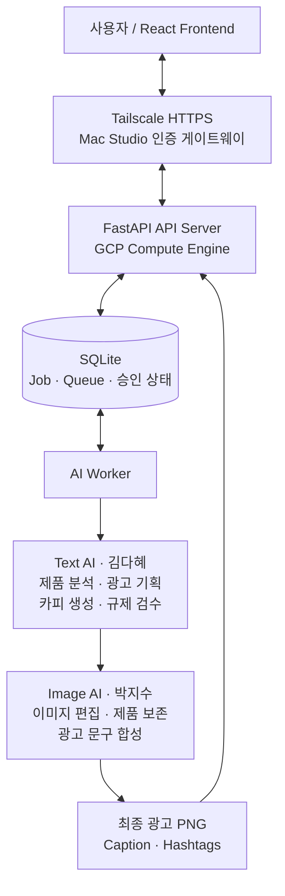
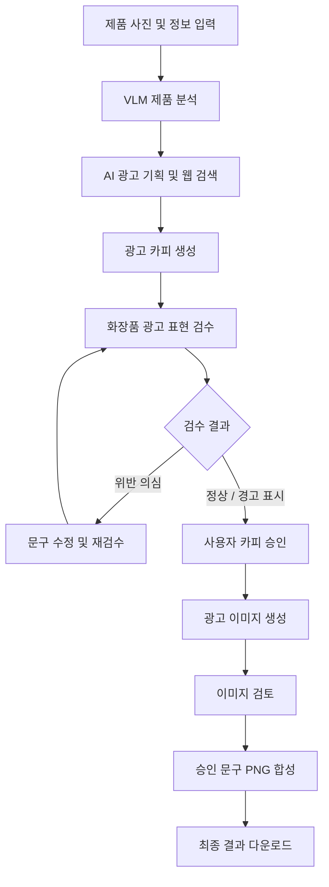

# project-it-tem
# IT-TEM Development

소상공인 AI 광고 콘텐츠 제작 서비스의 개발 구조와
각 모듈의 연동 방식을 정리한 문서입니다.

> Branch: `dev`  
> Project: IT-TEM  
> 개발 기간: 2026.10.15 ~ 2026.11.13

---

## 1. 시스템 아키텍처

서비스는 React 프론트엔드, FastAPI 백엔드,
비동기 AI Worker, 텍스트 AI 및 이미지 AI 모듈로 구성됩니다.

### 주요 구성 요소

| 구성 요소 | 담당 | 주요 기술 및 역할 |
|---|---|---|
| Frontend | 권혁상 | React 19, TypeScript, Vite |
| Backend | 이형기 | FastAPI, Uvicorn |
| Job / Queue | 이형기 | SQLite 기반 비동기 작업 관리 |
| AI Worker | 이형기 | AI 호출 및 처리 결과 관리 |
| Text AI | 김다혜 | VLM, LLM, 광고 기획, 규제 검수 |
| Image AI | 박지수 | 이미지 편집 API, PNG 합성 |
| Infrastructure | 이형기 | GCP, Tailscale, SSH |
| PM | 이태민 | 서비스 기획, 통합 점검 및 평가 |

---

## 2. AI 처리 파이프라인

광고 생성 과정은 단계별로 구분됩니다.

### 처리 원칙

- 카피 승인 이후 이미지 생성 진행
- 위반 의심 문구는 승인 차단
- 카피 수정 후 규제 검수 재실행
- 이미지 생성과 문구 합성 분리
- 합성 재시도 시 기존 생성 이미지 재사용
- AI 생성 작업은 비동기 Job으로 관리

---

## 3. Backend 및 비동기 작업 구조

FastAPI는 사용자 요청을 접수하고 작업 상태를 관리합니다.

실제 AI 처리는 별도의 Worker에서 수행하도록
API 서버와 생성 작업을 분리했습니다.

### 작업 처리 방식

1. 사용자 요청 접수
2. Job 생성 및 SQLite에 상태 저장
3. AI Worker에서 작업 실행
4. 단계별 처리 결과 및 승인 상태 저장
5. 프론트엔드에서 작업 상태 조회
6. 최종 결과 생성 및 다운로드

### 주요 설계 특징

- Job 기반 비동기 AI 처리
- 단계별 카피 및 이미지 승인 상태 관리
- 실패 작업 격리 및 정상 작업 처리 유지
- 사용자별 작업 조회와 이어하기
- 기존 생성 결과 재사용
- 생성 산출물의 SHA-256 무결성 검증

---

## 4. 프론트엔드 구조

### 주요 기술

| 기술 | 사용 목적 |
|---|---|
| React 19 | 웹 UI 구현 |
| TypeScript | 타입 안정성 및 API 스키마 연동 |
| Vite | 개발 및 빌드 환경 |
| TanStack Query | 서버 상태 조회 및 결과 캐싱 |
| Zustand | 사용자 입력 및 세션 상태 |
| React Router | 페이지 이동 및 라우팅 |
| MSW | Mock API 테스트 |

### 사용자 화면

1. 제품 정보 입력
2. 광고 카피 검토
3. 광고 이미지 검토
4. 최종 결과 확인

AI 생성 및 승인 요청은 사용자 클릭으로 실행하고,
서버 상태 조회는 별도로 관리합니다.

---

## 5. 개발 및 배포 환경

| 항목 | 구성 |
|---|---|
| Cloud | Google Cloud Platform |
| Compute | GCP Compute Engine |
| OS | Ubuntu 22.04.5 |
| GPU | NVIDIA L4 |
| VM | g2-standard-4 |
| API Server | FastAPI / Uvicorn |
| Database / Queue | SQLite |
| AI Processing | Dedicated AI Worker |
| Access | Tailscale HTTPS |
| Version Control | GitHub |

GCP API 서버는 외부에 직접 공개하지 않고,
인증된 내부 연결 경로를 통해 접근하도록 구성했습니다.

---

## 6. 통합 검증

2026년 11월 12일 서빙 파트의 최종 보고 기준입니다.

| 검증 항목 | 결과 |
|---|---|
| 실제 AI LIVE E2E | 6/6 조합 PASS |
| 완료 광고 Job | 25건 |
| 실제 Chrome 다운로드 | 6/6 PASS |
| FE 회귀 테스트 | 65/65 PASS |
| Backend / Worker 테스트 | 39/39 PASS |
| 반응형 화면 검사 | 24/24 PASS |
| GCP Health Check | 7/7 PASS |

전체 팀원의 최종 사용자 수용 테스트와
기술적 LIVE E2E 검증은 구분합니다.

---

## 7. 프로젝트 개발 담당

| 이름 | 역할 |
|---|---|
| 이태민 | PM · 기획 및 평가 |
| 김다혜 | Text AI |
| 박지수 | Image AI |
| 권혁상 | Frontend |
| 이형기 | Backend · Serving · Infrastructure |
