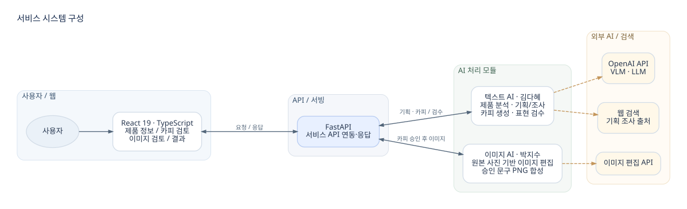
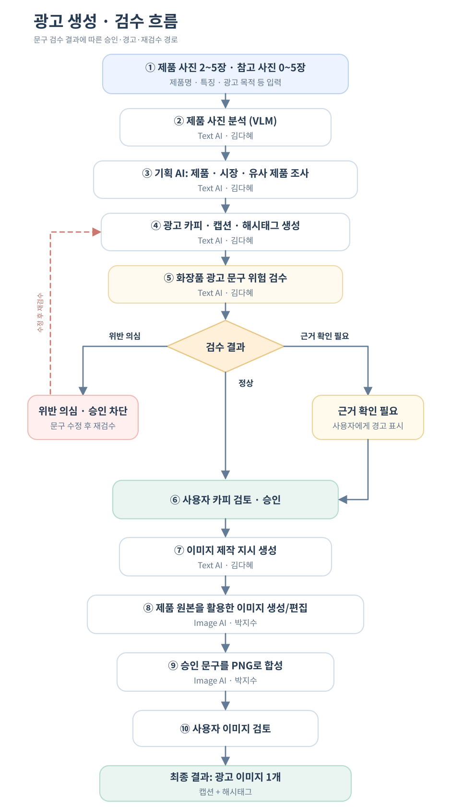
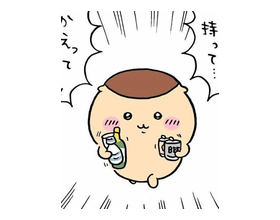

# project-it-tem

# 소상공인 AI 광고 콘텐츠 제작 서비스

**제품 사진부터 광고 기획, 카피 검수, 이미지 제작까지.**

화장품 판매 소상공인이 제품 사진과 제품 정보를 활용해 광고 콘텐츠를 제작할 수 있도록 구성한 생성형 AI 서비스입니다.

[**서비스 데모 접속하기**](https://macstudio-macstudio.tail17dfff.ts.net:10444/) · `2026.10.15 ~ 2026.11.13` · **5인 팀 프로젝트**

> 데모 주소는 팀에서 공유한 링크입니다. Tailscale 네트워크 정책에 따라 외부 접속이 제한될 수 있으며, 현재 공개 접속 여부는 확인되지 않았습니다.
>


[**팀 노션 접속하기**](https://app.notion.com/p/_2-3fbb13f77dbd8040b6d3d15c809dfcd9?source=copy_link)
---

## 1. 프로젝트 소개

안녕하세요. 이번 프로젝트에서 PM을 맡은 **이태민**입니다.

저희 팀은 소상공인이 광고 이미지를 만드는 데 필요한 기획과 디자인 과정을 줄일 수 있도록 이 서비스를 개발했습니다.

사용자가 제품 사진과 정보를 입력하면 **텍스트 AI가 광고 방향과 문구를 제안**하고, 문구 검토 및 승인 이후 **이미지 AI가 제품 중심 광고 이미지를 제작**합니다.

최종 결과는 **인스타그램 광고 이미지(기본 4:5)**와 별도의 **캡션·해시태그**로 제공합니다. 실제 통합 서비스에서는 **자유형(Freeform)·합성형(Composed)과 3:4·4:5·9:16의 총 6개 생성 조합**을 지원합니다.

### 주요 기능

| 기능 | 설명 |
| --- | --- |
| 제품·참고 사진 입력 | 제품 사진 2~5장과 배경·구도 참고 사진 0~5장 입력 |
| 광고 기획 | 제품 분석, 시장·유사 제품 조사, 광고 방향 제안 |
| 광고 카피 생성 | 헤드라인, 서브카피, CTA, 캡션, 해시태그 생성 |
| 화장품 광고 표현 검수 | 위험 수준에 따른 경고·승인 차단 및 수정 후 재검수 |
| 광고 이미지 제작 | 자유형·합성형, 3개 이미지 비율 선택, 이미지 검수·승인 및 최종 광고 생성 |
| 결과 제공 | 최종 광고 이미지와 게시글 본문·해시태그 출력 |

---

## 2. 시스템 아키텍처

프론트엔드와 API 서버, 텍스트 AI와 이미지 AI 모듈이 연동되는 전체 구조입니다.

각 모듈은 담당 영역에 따라 구분했으며, 텍스트 AI는 **김다혜**, 이미지 AI는 **박지수**가 담당했습니다.

<p align="center">
  
</p>

### 시스템 구성

| 계층 | 담당 | 구현 요소 |
| --- | --- | --- |
| **Frontend** | 권혁상 | React 19, TypeScript, Vite, TanStack Query, Zustand, React Router |
| **Backend / Serving / Infra** | 이형기 | GCP VM·서비스 배포, FastAPI API 연동, SQLite Job·Queue, 비동기 AI Worker, Tailscale 인증·접속, 통합 E2E 검증 |
| **Text AI** | **김다혜** | VLM 제품 분석, 기획·웹 검색, 카피 생성, 화장품 광고 문구 검수 |
| **Image AI** | **박지수** | 원본 사진 기반 이미지 편집, 제품 보존, 광고 문구 PNG 합성 |
| **PM** | 이태민 | 기획, 일정·협업 관리, 사용성 테스트·평가 |

> 다이어그램은 모듈 간 논리적 구성을 나타냅니다. 실제 서비스는 GCP의 FastAPI 서버, SQLite 기반 작업 큐, 전용 AI Worker 및 Tailscale HTTPS 접속 구조로 배포·운영했습니다.

---

## 3. 서비스 처리 흐름

사용자는 다음 네 화면을 순서대로 이용합니다.

**제품 정보 입력 → 카피 검토 → 이미지 검토 → 최종 결과**

내부적으로는 제품 분석과 광고 기획, 카피 생성 및 검수, 사용자 승인, 이미지 제작과 합성 순서로 처리됩니다.

<p align="center">
  
</p>

### 처리 과정

**STEP 01. 제품 정보 입력**

사용자가 제품 사진과 제품명, 특징, 광고 목적 등의 정보를 입력합니다.

**STEP 02. 제품 분석 및 광고 기획**

텍스트 AI가 입력된 제품 사진과 정보를 분석하고, 웹 검색 등을 활용해 광고 방향을 수립합니다.

**STEP 03. 광고 카피 생성**

광고 방향을 바탕으로 헤드라인, 서브카피, CTA, 게시글 캡션과 해시태그를 생성합니다.

**STEP 04. 광고 문구 검수**

화장품 광고 표현에 대한 규칙을 적용하여 위험 여부를 확인합니다.

- 정상: 검토 단계 진행
- 근거 확인 필요: 사용자에게 경고 표시
- 위반 의심: 승인 차단 및 문구 수정 필요

**STEP 05. 사용자 승인**

사용자가 생성된 광고 문구를 확인하고 승인합니다. 문구 수정이 발생하면 재검수를 진행합니다.

**STEP 06. 광고 이미지 제작**

승인된 광고 방향과 문구를 활용해 제품 중심의 광고 이미지를 생성·편집합니다.

**STEP 07. 최종 결과 제공**

광고 이미지에 승인된 문구를 합성하고 최종 결과물과 캡션·해시태그를 제공합니다.

> 광고 문구 검수는 위험 표현을 탐지하고 사용자에게 안내하기 위한 기능이며, 법적 판단을 대신하지 않습니다.

---

## 4. 기술 스택 및 구현

각 담당자는 서비스의 주요 기능을 나누어 개발하고, 모듈 간 연동을 통해 전체 광고 제작 과정을 구성했습니다.

### 4.1 Text AI — 김다혜

**담당: 제품 분석, 광고 기획, 카피 생성 및 규제 검수**

- VLM을 이용한 제품 사진 분석
- 웹 검색을 활용한 제품·시장·유사 제품 조사
- 광고 콘셉트 및 카피·캡션·해시태그 생성
- 사용자 입력, 웹 검색 출처, AI 추론 내용 구분
- 화장품 광고 표현 검수 규칙 적용
  - 일반 규칙 33개
  - 기능성 규칙 7개
  - 색조 제품 예외 고려
- 사용자 수정 요청 시 요청한 부분을 수정하고 재검수하도록 구성
- 위험 표현에 대한 경고·승인 차단 처리

### 4.2 Image AI — 박지수

**담당: 광고 이미지 생성·편집 및 제품 보존**

- 제품 사진과 보존 지시를 이용한 이미지 편집 API 활용
- 입력 제품의 외형 및 주요 특징 보존을 고려한 프롬프트 구성
- 광고 이미지 생성과 텍스트 합성 과정 분리
- 승인된 헤드라인, 서브카피, CTA를 PNG 이미지에 합성
- 이미 생성된 이미지에 문구만 다시 합성하는 경우 추가 이미지 API 호출 없이 처리
- 제품과 배경의 자연스러운 조화를 위한 프롬프트 실험

> 테마·글꼴 선택, 추가 생성 경로 등의 실험은 현재 서비스에 통합된 기능과 구분하여 관리했습니다.

### 4.3 Frontend — 권혁상

**담당: React 기반 사용자 인터페이스 및 서비스 연동**

- React 19 / TypeScript / Vite 기반 웹 프론트엔드
- 제품 정보 입력, 카피 검토, 이미지 검토, 최종 결과의 4단계 화면 구현
- TanStack Query를 통한 서버 상태 관리
- Zustand를 활용한 사용자 입력 및 세션 상태 관리
- 사용자 클릭을 기반으로 AI 생성·승인 요청 처리
- API 응답 상태에 따른 화면 및 예외 처리
- 목업·스텁 서버 기반 테스트와 실제 AI 통합 검증 구분

### 4.4 Backend / Serving / Infrastructure — 이형기

**담당: GCP 클라우드 인프라 구축·배포, FastAPI 백엔드, AI 모델 서빙 통합, 비동기 작업·상태 관리, 장애 대응 및 E2E 검증**

- **클라우드 인프라:** GCP VM(Ubuntu·NVIDIA L4) 구축, 디스크 확장, Python 서빙 환경 구성 및 배포
- **백엔드·AI 통합:** FastAPI API 구현, Text·Image AI 모듈 연동, 카피 승인·이미지 생성·합성·다운로드 흐름 통합
- **비동기 처리·데이터 관리:** SQLite Job·Queue, 전용 AI Worker, 작업 상태·승인 이력 저장, 사용자별 작업 조회·이어하기
- **서비스 접속·안정화:** Tailscale HTTPS 자동 로그인, Worker 오류 격리, 카피 수정 후 출처 검증 오류 및 무한 대기 장애 해결
- **통합 검증·릴리스 관리:** 실제 AI LIVE E2E 6/6 조합 검증, GCP 배포·회귀 테스트, Git 버전 관리·백업·복구 기준점 확보

**주요 성과:** 자유형·합성형 × 3개 비율의 실제 AI 광고 생성 경로 검증, 완료 광고 Job 25건, 프론트엔드 65/65 및 백엔드·Worker 39/39 회귀 테스트 통과, 검증된 제품 기준점의 GitHub `dev` 통합 완료.

> E2E 6/6은 실제 AI 생성·승인 및 브라우저 다운로드를 연결한 기술 검증 결과입니다. 팀원 전원이 처음부터 끝까지 직접 조작하는 사용자 UAT와는 구분합니다.

---

## 5. 개발 중 해결한 문제

개발 과정에서는 각 모듈의 기능 구현뿐 아니라 실제 연동 과정에서 발생한 문제를 확인하고 개선했습니다.

| 분야 | 발생한 문제 | 대응 |
| --- | --- | --- |
| **Text AI** | LLM JSON 출력이 중간에 잘리는 현상 | 추론 강도와 최대 출력 토큰 설정 조정 |
| **Text AI** | 광고 표현 검수의 오탐 및 누락 | 규칙·정규식 개선과 별도 평가 진행 |
| **Image AI** | 제품과 배경의 광원 불일치 | 장면 재설계 및 반사·접촉 그림자 지시 개선 실험 |
| **Frontend** | Mock 종료 후 실서버로 요청이 전달되는 현상 | MSW 핸들러 처리 방식 변경 |
| **Backend / Serving** | 특정 AI Job 오류로 Worker 전체가 중단되고 다른 사용자 작업까지 무한 대기 | 실패 Job만 격리하고 정상 Queue 처리를 지속하도록 개선 |
| **Backend / Serving** | 카피 수정·승인 후 이미지 프롬프트 생성 시 출처 검증 오류 | 최신 승인 카피·출처 증빙을 연결하도록 수정하고, 기존 작업을 안전하게 복구 |

### 텍스트 광고 표현 검수 평가

내부 100문장 평가셋을 기반으로 검수 규칙을 개선하고 성능 변화를 측정했습니다.

| 평가 항목 | 규칙 수정 전 | 규칙 수정 후 |
| --- | --- | --- |
| Recall | 88.0% | 100% |
| Precision | 84.6% | 98.0% |
| F1 Score | **86.3%** | **99.0%** |
| 오탐률 | 16% | 2% |
| 위험도 일치율 | 85% | 99% |

별도 홀드아웃 30문장에서도 검수 결과를 평가했습니다.

- 위반 문장 Recall: 100% (21/21)
- Precision: 100%
- F1 Score: 100%
- 정상 문장 오탐: 0/9
- 위험도 일치율: 100%

> 위 수치는 내부 평가셋 기준이며, 실제 서비스 전체 성능이나 법적 적합성을 보증하지 않습니다.

---

## 6. 함께 만든 사람들

지금까지 서비스의 구조와 주요 개발 내용을 소개했습니다.

마지막으로 각 분야를 맡아 개발한 팀원들을 소개합니다.

|  |  |  |  |  |
| :---: | :---: | :---: | :---: | :---: |
| **이태민** | **김다혜** | **권혁상** | **박지수** | **이형기** |
| PM | Text AI | Frontend | Image AI | Backend |

### 담당 업무

| 이름 | 담당 | 주요 작업 |
| --- | --- | --- |
| **이태민** | PM · 기획/평가 | 프로젝트 기획, 일정 관리, 협업 조율, 사용성 테스트 및 평가 |
| **김다혜** | Text AI | 제품 분석, 광고 기획, 카피 생성, 화장품 광고 문구 검수 |
| **권혁상** | Frontend | React 화면 구현, 상태 관리, API 연동, 예외 처리 |
| **박지수** | Image AI | 이미지 생성·편집, 제품 보존, 승인 문구 합성 |
| **이형기** | Backend · Serving · Infrastructure | GCP 인프라 구축·배포, FastAPI·AI 모듈 통합, Job·Queue·Worker, 인증·작업 관리, 장애 해결 및 LIVE E2E 검증 |

## 7. 서비스 데모 및 실행 안내

### 서비스 데모

제품 정보 입력부터 광고 카피 검토, 이미지 검토, 최종 결과 확인까지 진행할 수 있는 서비스입니다.

[**서비스 데모 바로가기**](https://macstudio-macstudio.tail17dfff.ts.net:10444/)

> 팀에서 공유한 서비스 주소이며, 네트워크 환경에 따라 접속이 제한될 수 있습니다.

### 실행 안내

- **배포 환경:** GCP Compute Engine 기반 FastAPI 서버와 전용 AI Worker
- **서비스 접속:** Tailscale HTTPS를 통한 팀원 전용 내부 베타
- **통합 검증:** 실제 Text·Image AI 광고 생성 6개 조합 검증 완료
- **실행 자료:** [개발 API 목록 및 실행 안내 (dev)](https://github.com/taemin050-sys/project-it-tem/blob/dev/docs/API_LIST.md) 참조

> 본 서비스는 내부 발표·테스트용 베타입니다. 운영 API 키와 인증 정보는 README에 공개하지 않으며, 실제 GCP 배포 설정 및 사용자별 접근은 별도로 관리합니다.

---

## 8. 프로젝트 파일 구성

README에 사용한 이미지와 구조도는 다음과 같이 관리합니다.

```text
project-it-tem/
├── README.md
├── CONTRIBUTING.md
│
└── assets/
    ├── diagrams/
    │   ├── system_architecture.svg
    │   ├── system_architecture.dot
    │   └── service_flow.svg
    │
    └── team/
        ├── taemin.png
        ├── taemin_card.png
        ├── dahye.png
        ├── dahye_card.png
        ├── hyeoksang.png
        ├── hyeoksang_card.png
        ├── jisu.png
        ├── jisu_card.png
        ├── hyeonggi.png
        └── hyeonggi_card.png
```

---

<p align="center">
  <strong>태(민)가 나고, 향기(형기)나고, 지수 오르는, 혁상적인 광고 다혜 드립니다</strong>
</p>

<p align="center">
  <sub>소상공인을 위한 AI 광고 콘텐츠 제작 서비스 · 2026</sub>
</p>
