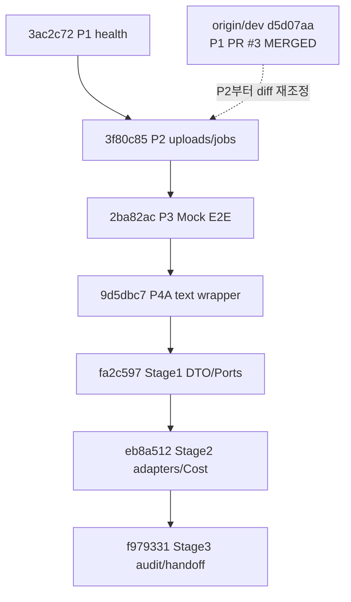

# IT-TEM 통합 구현·PR 병합 로드맵 (10/26 계약 v0.2)

> **원칙:** 계약을 팀원별로 먼저 배포 → 각 파트 Fake로 독립 개발 → 안전한 feature 통합 → 보호 계층 → 단계별 Live/Browser.
> **Git 검증 당시:** `main=05ed2b0`, `dev=d5d07aa` (P1 PR #3 병합), `feat/p4-contract-handoff=f979331` (누적 feature). 확인 시각 이후 이동했다면 재조회한다.

## 1. 실제 Git 계보 — 중복 병합 금지



- `feat/p4-contract-handoff`를 `dev`로 통째 병합하면 **P2~Stage3 누적 변경**이 한꺼번에 들어오므로, PM/서빙 통합 담당이 diff/테스트를 보고 결정한다. 각 후속 브랜치를 서로 별도의 독립 feature로 생각하지 않는다.
- `docs/meeting-contract-v02-20261026`는 **`dev` 기반 문서만 포함**한 PR #4이며, API 구현을 실수로 함께 병합하지 않는다.
- 후속 기능은 **선행 커밋의 `dev` 반영 여부 확인 → 정확한 diff → 새 dev-based PR 또는 체리픽 → 해당 테스트** 순서. direct dev/main push, force push, 무단 reset/clean 금지.

## 2. 단계·산출물·완료 기준

| 단계 | 담당 / 병렬성 | 산출물 | 검증 게이트 |
|---|---|---|---|
| **S0 계약 재감사** | 서빙 + PM | v0.1 보존 + v0.2 회의결정·보류·API/DTO 표 복원 | 누락·상충·잘못된 구현 완료 표시 0 |
| **S1 배포 패키지** | 서빙→전원 | 공통 4종·담당별 5종·7 Fixture·예제·배포문 | 인덱스 링크/고정 SHA, 정적 검사 PASS |
| **S2 계약 PR** | PM+영향 담당 | docs-only PR #4, `dev/docs/interface_spec.md` | 승인/병합. 보류/제안은 계속 구분 |
| **S3 선행 기능 통합** | PM+서빙 | P2→P3→P4A→Stage1→Stage2→Stage3 | 누적 diff/회귀 테스트 118/감사 PASS |
| **S4 실제 텍스트 스키마 연결** | 김다혜 + 서빙 + React | 정식 v0.5 스키마/Fixture, mapper, 신규 ProductInput/VLM/Research/Copy/Compliance API | 필드 손실 0 / citations 정직 / false 서버 승인 차단 |
| **S5 이미지·합성 + 실행 보호** | 박지수 + 서빙 + PM | Image Wrapper·Composition, revision/hash, suboperation Cost Guard | 이미지 bytes SHA/PNG/승인·비용 회귀 PASS |
| **S6 React/Live E2E** | 전원 | OpenAPI→TS SDK, Browser E2E, Live 로그, 품질·보안/비용 보고 | Contract/Mock/Live/Browser 별도 수용 결과 |
| **S7 고도화** | 해당 owner | 같은 제품 분석·거절 재편집·합성 템플릿·추가 정책 | 변경 계약 버전·실험 근거로 독립 PR |

**병렬:** S2~S3 중 텍스트/이미지 파트는 자기 wrapper/Fake Fixture/샘플을 제작하고 React는 UI를 Fixture로 먼저 구현. **서빙은 공통 JobStore·API·승인·비용 코드 소유**, 각 모델은 독립 모듈 구현을 지속한다.

## 3. 후속 API 개발 전 결정해야 할 wire 항목 (문서 PR에 임의 구현하지 않음)

| API 이슈 | 현재 | 구현 전 최소 결정 |
|---|---|---|
| ProductInput 포함 Job 생성 | 기존 `/jobs` multipart 사진만 | input 필드 전달 방식(FormData JSON field 등)·검증·응답 |
| VLM 분석 결과 | 현행 없음 | 호출 시점, `is_cosmetic=false` 오류/상태, 결과 저장·조회 |
| Research/Copy/Compliance 조회 | 현행 Job의 provisional `plan`/`copy` 구조 | 새 화면 조회 body, provenance, 승인 대상 revision/hash |
| 이미지 생성·합성 | Mock만 공개; 실 API 미구현 | 실제 경로, 입력 asset/Prompt, 출력 MIME/hash, 실패·시간초과 규칙 |
| 상태·승인 | 9개·Boolean | 새 VLM/검수 상태, 서버 차단 HTTP 오류·수정 후 무효화 |
| 비용 보호 | `(job_id,stage)` 예약만 | suboperation key + 동일 입력 dedupe + unknown 조회·실청구 대조 |
| 사진 리사이즈 | 10MiB/60MiB/40MP 거절 | 물리적 요청 상한·이미지 decoding/memory·압축 옵션 |

**실제 앱의 OpenAPI 출력만** React TS 타입 생성에 사용하고, 목표 계약의 타입을 현재 API처럼 제공하지 않는다.

## 4. 변경·PR 템플릿 및 검증 체크리스트

```markdown
### PR 계약 영향
- Contract: v0.2 / C-ID / API·DTO·status 변경 여부
- Base SHA / Feature ancestor / 실제 diff 범위:
- Owner / PM Reviewer / 영향 파트:
- Fixture (정상·실패) 및 Pydantic/OpenAPI/TS 변경:
- Unit / regression / Mock / Live / Browser 검증별 PASS·NOT_TESTED:
- Billable flag / 호출수 / 팀 $10 예산 사용량:
- Security / Key / Error / idempotency / rollback:
```

| 인수 영역 | 필요 증빙 | 현재 최초 기준 |
|---|---|---|
| **Contract** | Pydantic v0.5 schema+mapper round-trip / 실제 OpenAPI + TS | 회의 스키마 공유, 실원본 연동 미검증 |
| **Mock** | 업로드→2회 승인→PNG·caption, 승인 전 409 | feature `f979331` PASS |
| **Live Text** | VLM·검색 실제 URL·카피·Compliance/비용 | NOT_TESTED |
| **Live Image/Composer** | 이미지 진짜 bytes·1080×1350·한글·제품보존 | NOT_TESTED |
| **React Browser** | 실제 브라우저 input→review→approve→download | NOT_TESTED |
| **Cost/Security** | 팀 $10/중복/timeout/429/청구 unknown / credential | 미완성 |
| **Ad/Design QA** | 규제 경고·대체카피·라벨/로고 사람 검토 | 미검증 |

**데모 수용은 위 항목을 독립 판정한다.** 하나의 PASS로 다른 미검증 영역을 대신할 수 없다.


## 독립 감사 후 통합 선행 게이트 (R0~R6)

| 게이트 | 현행 산출물 / 결과 | 다음 Owner 조건 |
|---|---|---|
| R0 원격 재조회 | PR #4 유지, `dev=d5d07aa`, `f979331` feature | 통합 전 원격 SHA 재조회 |
| R1 위치 검증 | [소스 필드 검증기](validation.py) 및 `tests/test_contract_review_validation.py` | 서빙 Approval Endpoint 실제 테스트는 **후속 구현 PR** |
| R2 Wire 계약 | [7개 비동결 후보](examples/wire_proposals.json), [VLM false/unknown](examples/vlm_outcomes_proposed.json) | 텍스트·이미지 실제 wrapper signature + React/서빙+PM 명시 승인 |
| R3 스키마/TS | `check_owner_schema.py` (해시 명시 검증), 현행 OpenAPI와 TypeScript 분리 | 텍스트 원본 repo/SHA, Image wrapper, TS 프로젝트 실제 빌드 |
| R4 비용/업로드/출처·접근 | [SSOT 7.3~7.5](../interface_spec.md) 정책/기술 위험 분리 | hard cap/계정 목록/보안 접속 방식 승인 + 별도 런타임 PR |
| R5 문서 계약 재감사 | [DOCUMENT_AUDIT.md](DOCUMENT_AUDIT.md): P0 7/P1 10 상태·테스트 | 독립 감사 재검토, PM 승인 전 병합 금지 |
| R6 실제 서빙 통합 | **미착수** (PR #4는 docs+contract tests) | P2→Stage3 순차 dev 인수, 실제 13 API/118 회귀 및 새 검증 구분 |

**개발 허가 경계:** Owner는 v0.5 내부 DTO·Fake Wrapper 개발 가능. **신규 HTTP 라우터와 React SDK의 확정 타입은 FROZEN_WIRE + 실제 OpenAPI/TypeScript 증거가 있어야** 동결·통합한다. 미동결 필드는 Mock/Fake label로 분명히 표시. GCP VM 관리·유료 호출은 별도 PM 승인 유지.
