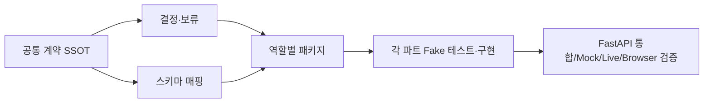

# IT-TEM 팀 공통 연동 패키지 · 2026-10-26 / Contract v0.2

> **진입점:** 전체 팀은 이 문서를 먼저 읽고, 담당자별 파일은 **각자 하나만 추가** 읽으면 된다.
> **리뷰 상태:** 계약 PR #4 (머지 전 회의 반영안) · **코드 기준:** `dev=d5d07aa` / 기능 브랜치 `f979331`
> **원칙:** 의미·정책의 공식 SSOT는 `../interface_spec.md`. 이 폴더는 이해·실행·검증용 가이드로, 동일 계약을 다시 정의하지 않는다.

## 1. 먼저 읽는 공통 기준 (순서 고정)

| 순서 | 파일 | 반드시 확인할 내용 |
|---|---|---|
| ① | **[통합 계약 v0.2](../interface_spec.md)** | 제품·프로세스, 13개 현행 API, 상태, v0.5 필드, 이미지·비용·승인·인수 규칙 |
| ② | **[결정 레지스터](DECISION_REGISTER.md)** | 10/26 확정·실험·고도화, C-01~12 변경 영향 |
| ③ | **[스키마 매핑](SCHEMA_MAPPING.md)** | 텍스트 v0.5 → 기존 Serving DTO/HTTP의 실제 차이 |
| ④ | **[구현·병합 로드맵](IMPLEMENTATION_PLAN.md)** | `dev` vs 누적 feature, 순차 PR·단계별 완료 게이트 |



## 2. 담당자에게 배포할 자료

**전 팀원:** 위 공통 4개 + [팀 공지문](TEAM_DISTRIBUTION.md).
**개별:** 공통 문서를 중복 복제한 첨부파일이 아니라 **같은 Git 커밋의 링크**와 아래 자기 파트 파일 1개를 전달한다.

| 담당 | 추가 1개 문서 | 바로 수행할 핵심 작업 | 검증 증거 |
|---|---|---|---|
| **권혁상 / React** | [FRONTEND.md](partners/FRONTEND.md) | 사용자 입력·조사 요약·규제 경고·승인·다운로드 | TS build + Browser E2E |
| **김다혜 / 텍스트 AI** | [TEXT_AI.md](partners/TEXT_AI.md) | v0.5 원본·VLM·Research·Copy·Compliance·Prompt Wrapper | Schema / Fake / citation / risk Fixture |
| **박지수 / 이미지·합성** | [IMAGE_COMPOSER.md](partners/IMAGE_COMPOSER.md) | OpenAI Wrapper·원형 보존·Composition | PNG·메타데이터·한글·외형 QA |
| **이형기 / 서빙** | [SERVING.md](partners/SERVING.md) | Job·자산·상태·비용·스키마 매핑·통합 | Contract / Regression / Cost / Mock |
| **이태민 / PM·QA** | [PM_QA.md](partners/PM_QA.md) | 계약 변경·예산·branch merge·수용 판정 | 승인·검증 증빙 레지스터 |

## 3. 현재 구현 현실 / 패키지 증거 수준

| 유형 | 현재 위치 | 해석 |
|---|---|---|
| P1 health | `dev` (`d5d07aa`) | 현재 `dev`에 실제 존재 |
| HTTP 13개·9개 상태·118개 회귀 | `feat/p4-contract-handoff` (`f979331`) | feature 구현, `dev` 미병합 |
| 텍스트 `schemas.py v0.5` | 회의에서 공유된 정의 | **실제 팀원 저장소 원본 path/commit 검증 후 정식 동결** |
| [샘플 Fixture](fixtures/README.md) 7개 | 본 PR | 합성 예제, Live도 HTTP wire도 아니며 Pydantic 검증 전 |
| [TS 업로드 샘플](examples/frontend_legacy_upload.ts) | 본 PR | 구 feature HTTP 예제, 현 `dev` API가 아님 |
| 모델·React Live 통합 | 미검증 | 테스트 결과 PASS로 표시 금지 |

## 4. 문서 vs 기계 판독 계약 사용 규칙

```text
텍스트팀 실제 schemas.py v0.5 --(Pydantic JSON Schema/fixtures)--> 텍스트 내부 계약
          ↓ 서빙의 무손실 Mapper 테스트
구현된 FastAPI + /openapi.json ------(타입 생성)------> React TS API 타입
          ↓                                                                    ↓
        pytest Contract/Mock -----------------------> React Browser E2E
```

기존 feature의 `scripts/export_p4_contracts.py`는 **legacy 내부 DTO 7종**에 대한 산출물이다. 새로운 v0.5/HTTP 타입이 자동으로 반영된 것이 아니다. **정식 파일명·엔드포인트가 확정되지 않은 항목을 현재 가동 중 API처럼 문서화하지 않는다.**

이번 문서별 재검토 결과와 검증 한계는 **[DOCUMENT_AUDIT.md](DOCUMENT_AUDIT.md)**에서 확인한다.

## 5. 검증·배포 절차

1. `python3 docs/contracts/validate_package.py`로 **배포 문서·합성 Fixture 정적 검사** (외부 호출 0).
2. 계약 PR 리뷰·병합 후 **고정 Git commit SHA**를 전원에게 배포한다. `TEAM_DISTRIBUTION.md` 사용.
3. 각 파트는 자기 가이드의 입력/출력 Fixture와 오류 케이스를 제출한다.
4. 서빙은 실제 코드 OpenAPI·JSON Schema·TS·Contract Test를 맞춘다. Contract/Mock/Live/Browser/QA는 분리 판정한다.
5. 이후 변경은 **계약 버전 + C-ID + 영향 담당 + 마이그레이션 + PR 링크**를 기록한다.

**보안:** 브라우저로 VM 8000 직접 접근 금지, API 키·민감 사진 Git/프론트 공유 금지, 팀 유료 API 베이스라인 실험 포함 $10 상한 및 서버 승인 게이트 기본 OFF.
