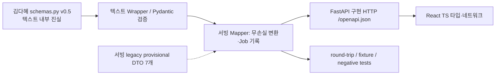

# 텍스트 `schemas.py v0.5` ↔ 서빙 DTO/HTTP 무손실 매핑 명세

> **원본 소유:** 김다혜 / 텍스트 파트. 이 문서는 그 스키마를 바꾸는 문서가 아니라 **서빙 호환·정보 보존·계약 테스트**를 위한 작업표다.
> **현재 상태:** 회의에서 전달된 v0.5 클래스 정의를 대조했으나, 텍스트 담당자 공식 저장소 모듈 path/commit SHA를 직접 확인한 상태는 아니다.
> **참조:** [공통 계약 제4·5장](../interface_spec.md), [합성 Fixture](fixtures/README.md).

## 1. 변환 경계 (SSOT 혼동 금지)



- `schemas.py v0.5` → 텍스트 모델의 **필드·타입·Literal 의미** 기준.
- FastAPI가 반환하는 `Job` JSON → **구현된 공개 HTTP wire**의 기준. 양자는 같지 않다.
- 기존 provisional 7 DTO → 레거시 내부 어댑터/검증의 자산. **텍스트 출력 또는 HTTP 타입으로 직접 재명명하지 않는다.**
- 필드가 양쪽에 없으면 **손실 없이 추가 영속화**, 필요 시 명시적인 변환·source metadata·revision을 기록한다. 단방향 요약으로 원본을 폐기하지 않는다.

## 2. 원본 모델별 필드 매핑

| v0.5 모델 / 필드 | 기존 서빙 데이터와 차이 | 서빙 변경 책임·데이터 보존 | 테스트 |
|---|---|---|---|
| `ProductInput.brand_name: str\|None`, `product_name` | `ProductFacts.brand_name`는 nullable 의미 상이; 기존 `/ai/plan`의 JSON 별도 | React form→Job input→Wrapper. nullable 보존 | 빈 브랜드/제품명 필수 |
| `product_category: str\|None` | 없음 | 미선택 null 보존, VLM `product_type`와 혼동 금지 | null/문자열 |
| `features: str`, `ad_purpose: str` | 기존 `product_facts: string[]`와 다름 | 문자열 그대로 저장, claim 검증 여부 별도 | 입력·기획 round-trip |
| `is_functional: bool`, `photo_verified: bool` | 기존 User Input DTO 없음 | 값 검증/저장, photo_verified는 권한 **확인 체크**뿐 | true/false/누락 |
| `product_image_count: 2..5`, `reference_image_count: 0..5` | 기존 HTTP는 FormData 파일 수만 검사 | 실제 서버 수신 asset 목록과 값 일치 | mismatch 차단 |
| `ProductAnalysis.is_cosmetic`, `product_type`, `container_type`, `colors`, `label_text`, `mood`, `is_transparent` | 기존 VLM 단계·Artifact 없음 | 사진 바이트→VLM→분석 결과 기록·Provenance `AI 추론` | 비화장품, 혼합 사진, 빈 배열 |
| `ResearchOutput.product_summary`, `functional_notes`, `market_insights`, `similar_products`, `ad_direction`, `display_summary` | `PlanResult`와 구조 다름 | **전체 ResearchOutput** 유지, `display_summary[{text,source}]` 화면 제공 | display_summary 정보 소실 0 |
| `ResearchResult.research`, `citations[{title?,url}]`, `research_performed` | `Evidence.source_id/type/verification_status`와 다름 | 검색 응답의 실제 `url_citation`만 citations 보존; false 시 AI 추론 | false/citation 위조 금지 |
| `AdCopyOutput.plan` (`target,concept,key_message,tone,mood`) | `PlanResult.audience/direction` 등 다른 구조 | AdPlan 원형 보존, ImagePrompt concept/mood 일치 | 무손실 왕복 |
| `ad_copy` (`headline,subline,cta`), `caption`, `hashtags` | 기존 `CopyResult.text` 하나, 게시글 구조 없음 | 구조화 카피 원형 저장, **copy approval hash 대상 정의** | 필드별 UTF-8/한글·hash |
| `ImagePromptOutput.concept,prompt,mood` | `VisualBrief.prompt_en`, mood 없음 | 한국어 prompt 그대로; mood 추가; negative 조건은 이미지 소유 | prompt 언어/일치 |
| `ComplianceReport.passed,issues,revised_fields,checklist,notice` | `CopyResult.risk_flags,compliance_checked`만 있음 | 리포트 **전체** 저장·조회, false 서버 승인 차단 | 승인 false HTTP 방어 |

## 3. v0.5 타입·검수 세부 계약

| 타입 | 필수 내용 |
|---|---|
| `SourceType` | `사용자 입력` · `검색 결과` · `AI 추론` (사진 분석 포함) |
| `ProductType` | `스킨케어` · `색조` · `바디` · `헤어` · `기타` |
| `ContainerType` | `병` · `튜브` · `펌프` · `스포이드` · `자` · `콤팩트` · `스프레이` · `파우치` · `기타` |
| `RiskLevel` | `정상` · `근거 확인 필요` · `위반 의심` |
| `RiskCategory` | `의약품 오인` · `기능성 오인` · `효능 과장` · `소비자 오인` · `수치·임상 표현` · `순위·최상급 표현` · `전문가·매체 추천` · `가상 후기` · `확정 정보 불일치` · `기타` |
| `CopyField` | `product_name`, `headline`, `subline`, `cta`, `caption`, `hashtags`, `user_text` |
| `LLMIssue` | `field,text,category,risk_level,reason,suggestion` — **시작/끝 위치는 반환하지 않음** |
| `ComplianceIssue` | `field,text,start,end,category,risk_level,reason,suggestion?,basis?,detected_by(rule\|llm),auto_fixed` — 위치는 **서빙/텍스트 조립 코드에서** 계산 |
| `ComplianceReport` | `passed` (위반 의심 0개일 때 True), `issues[]`, `revised_fields`, `checklist[]`, `notice` |

**정밀도 주의:** `start/end`는 `field`가 가리키는 **하나의 문자열 안**의 코드포인트 오프셋이다. React 문자열 길이 계산(JavaScript UTF-16)과 한글/이모지 경계를 실제 Fixture로 검증해야 한다. `hashtags` 배열의 어느 원소인지 지정하는 별도 인덱스는 v0.5에 없으므로, 하이라이트 표시 규칙은 HTTP 디자인 시 명시해야 한다.

## 4. DTO 객체별 산출·검증 순서

```mermaid
sequenceDiagram
    participant R as React
    participant S as Serving
    participant T as Text Wrapper
    participant I as Image Wrapper
    R->>S: ProductInput + files (2..5; refs 0..5)
    S->>S: validate files, count, asset ownership
    S->>T: product images bytes + ProductInput
    T-->>S: ProductAnalysis
    S->>T: Research request with validated context
    T-->>S: ResearchResult (actual citations)
    S->>T: Copy/Compliance generation
    T-->>S: AdCopyOutput + ComplianceReport + ImagePromptOutput
    S-->>R: Job-backed review payload (wire pending)
    R->>S: approve exact copy (after compliance)
    S->>S: content revision/hash/approved actor
    S->>I: approved copy + prompt/mood + asset bytes
    I-->>S: image bytes + metadata
    S-->>R: image review (wire pending)
```

**예제 입력** (v0.5 내부 `ProductInput`, **현재 POST /jobs의 확정 body 아님**):

```json
{
  "brand_name": null,
  "product_name": "라움 데일리 크림",
  "product_category": "스킨케어",
  "features": "부드러운 사용감",
  "ad_purpose": "신제품 소개",
  "is_functional": false,
  "photo_verified": true,
  "product_image_count": 2,
  "reference_image_count": 0
}
```

## 5. v0.5 vs 레거시 DTO 7종: 호환 전략

| 레거시 DTO | 유지하는 정보 | 신규 v0.5에서 추가해야 할 정보 |
|---|---|---|
| `ProductFacts` | 제품명/주장 및 출처 플래그 | ProductInput 목적·기능성·사진권한·category·실제 count |
| `Evidence` | 인용 메타데이터·정규화 | SourceType 분류 및 실제 OpenAI url_citation과 추론 구분 |
| `PlanResult` | plan·위험·조사 수행 플래그 | ResearchResult 전체 + AdPlan 무손실 기록 |
| `CopyResult` | 텍스트·risk_flags | CopySet/caption/hashtags + ComplianceReport 분리 |
| `VisualBrief` | copy_revision, prompt_en, safe_zone, negative | 한국어 prompt, mood + approved hash, 이미지팀 negative 고정 처리 |
| `ImageResult` | MIME/크기/hash/보존 평가 | 새 Image Wrapper의 실제 출력·JobStore 저장 |
| `GenerationReceipt` | provider/model/attempt/billing state | suboperation/usage 및 청구 불확실 상태 기록 |

## 6. 정식 승격을 위한 Contract Test 목록

- [ ] 김다혜 `schemas.py v0.5` 파일의 **실제 repo path + SHA** 확보 / `model_json_schema` 재생성
- [ ] ProductInput 누락/nullable/파일 count mismatch와 입력권한 체크 구분
- [ ] ProductAnalysis `is_cosmetic=false`와 `label_text` AI 추론 표시
- [ ] 실제 citation/인용 메타 vs AI가 만든 URL 거절 / 검색 실패 시 false
- [ ] ResearchOutput 전체·`display_summary` 왕복 보존
- [ ] CopySet, caption, hashtags·한국어·이모지·HTML escaping 왕복 보존
- [ ] Compliance 이슈 field/start/end 정확한 선택 영역·`passed=false` 서버 승인 거부
- [ ] ImagePrompt concept/mood/한국어 prompt → 이미지 wrapper 전달 일치
- [ ] 승인 revision/hash 무효화, Job/Asset ownership, 비용 ledger 중복 제한
- [ ] FastAPI 구현 `/openapi.json` → TS 타입과 신규 HTTP Fixture 일치 + 기존 13 API 회귀

**현재 첨부한 샘플 JSON은 합성 데이터이며 정식 Pydantic 검증·Live 검증 이전이다.** 이 문서는 필드를 *서빙 안에서* 새로 정의하도록 허가하지 않는다.
