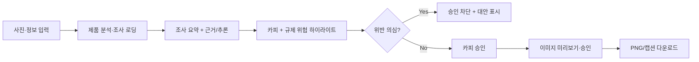

# 권혁상 · React Frontend 연동 패키지

> **필독:** [공통 SSOT](../../interface_spec.md) → [결정표](../DECISION_REGISTER.md) → [스키마 매핑](../SCHEMA_MAPPING.md). 이 문서는 React 담당 범위만 기술한다.
> **환경:** React + Vite + TypeScript · **API 기준:** 실제 FastAPI `/openapi.json` · **상태:** 새 v0.2 UI/HTTP 아직 연동 전.

## 1. 화면·데이터·상태의 대응

| 화면 | 필요한 값·역할 | 현재 vs 목표 |
|---|---|---|
| 입력·업로드 | 제품 2–5/참고 0–5장, `ProductInput`(제품명·특징·광고목적·기능성·사진 권한, nullable brand/category) | 기존 multipart 업로드는 feature에서만 구현 / 새 입력 필드 미연결 |
| 분석 진행 | `ProductAnalysis.is_cosmetic`, 화장품 여부/제품 속성 | VLM·HTTP 미구현. 비화장품 UX는 고도화 결정 대기 |
| 기획 조사 | `ResearchResult.research.display_summary[{text,source}]`, `citations`, `research_performed` | `사용자 입력`/`검색 결과`/`AI 추론`을 눈에 띄게 구별 |
| 카피 검토 | `AdCopyOutput.plan`, `ad_copy{headline,subline,cta}`, `caption`,`hashtags` | 5종 콘텐츠를 구조 유지한 채 렌더 |
| 규제 검사 | `ComplianceReport.passed,issues[],revised_fields,checklist,notice` | `field/start/end`를 해당 필드에 표시, 위험도/사유/대안 고지 |
| 카피 승인 | 승인 정확한 revision/hash, `passed=false` 시 차단 | 버튼 비활성화 + 서버 재검증 필수; 무단 우회 승인 금지 |
| 이미지 검토 | 실제 산출 이미지, 사용자 승인/거절 | Mock vs Live, preservation QA 상태 표시 |
| 결과 다운로드 | 1080×1350 PNG + UTF-8 caption/hashtags | 파일 실제 크기·본문 일치 확인 |

### 화면 흐름

## 2. 지금 바로 사용 가능한 레거시 HTTP (단, `dev` 미병합)

| 메서드 | 경로 | UI 처리 |
|---|---|---|
| `POST` | `/api/v1/jobs` | FormData 반복 필드 `product_images`, `reference_images`; 201 직접 Job JSON |
| `GET` | `/api/v1/jobs/{job_id}` | 단계 완료·새로고침 후 서버 기준으로 UI 동기화 |
| `POST` | `/api/v1/jobs/{job_id}/mock/plan`·`mock/copy`·`mock/image`·`mock/compose` | 실제 AI **아님** 표기 |
| `POST` | `/api/v1/jobs/{job_id}/approvals/copy`·`approvals/image` | `{"approved":true/false}`, 상태/409 처리 |
| `GET` | `/api/v1/jobs/{job_id}/artifacts/{kind}` | `plan/copy/image/final/caption` 다운로드 |
| `GET` | `/api/v1/capabilities` | 제공자 설정/준비 상태, Live 품질 보증 아님 |
| `POST` | `/api/v1/jobs/{job_id}/ai/plan`·`ai/copy` | 코드 준비만, 검색·유료 Live 안전성 미검증 |

[업로드 TypeScript 예제](../examples/frontend_legacy_upload.ts)는 **기능 브랜치의 기존 API용**이며 새 `ProductInput` 입력이나 v0.5 결과 조회까지 구현한 것이 아니다.

## 3. Mock/Live·오류 UX

| 상황 | 권장 사용자 처리 | 금지 |
|---|---|---|
| HTTP 409 | `GET Job` 재조회→정확한 상태 안내 | AI 요청 자동 재전송 |
| 모델 OFF/503 | 준비 중/실패 표시, 다시 실행 안내는 운영 정책 확인 후 | Mock 성공으로 조용히 변환 |
| Compliance `passed=false` | 경고·하이라이트·대안, 카피 승인 비활성화 | 클라이언트 버튼만으로 서버 통제했다고 주장 |
| 검색 실패 | 조사 실패 + AI 추론 표시 | 실제 조사 수행 완료 표시 |
| 저장된 결과 조회 | 서버 `job_id`로 확인, 버튼 중복 클릭 차단 | 응답 유실=공급자 미호출로 단정 |

**중요:** 브라우저의 `127.0.0.1`은 사용자 PC. 실제 VM은 인증·HTTPS·CORS·접속 방식을 팀이 승인한 후 연결한다. 새 VLM·Compliance HTTP path는 아직 미확정이므로 Mock Fixture 기반 개발을 먼저 진행한다.

## 4. 바로 수행할 작업·인수

- [ ] 이미지·입력 폼 + photo_verified 체크 및 2–5/0–5 제약. `brand_name`·`product_category` null 허용.
- [ ] [합성 Fixture](../fixtures/README.md)로 요약 출처·위험 `field/start/end`·대체 문구·responsibility notice 시연.
- [ ] 이미지 합성 방식과 각 카피 길이 임의 고정 금지; 가변 긴 한글·짧은 한글을 예제 카드로 검증.
- [ ] 레거시 Job/승인/409/다운로드를 허가된 백엔드에서 Mock Browser E2E로 확인.
- [ ] 실제 OpenAPI 구현 시 자동 생성 TypeScript 타입·빌드·실 브라우저 네트워크 기록 제출.
- [ ] Mock/Live·research_performed·compliance_passed·product_review를 **별도 상태**로 표시.

**완료 증빙:** TS build PASS, 브라우저 E2E 영상 또는 로그, 409 처리, compliance false 승인 불가, PNG 1080×1350 + caption, UI에서 AI 추론/실검색 구분. 새 경로 미구현 시 `NOT_TESTED`로 표시한다.
