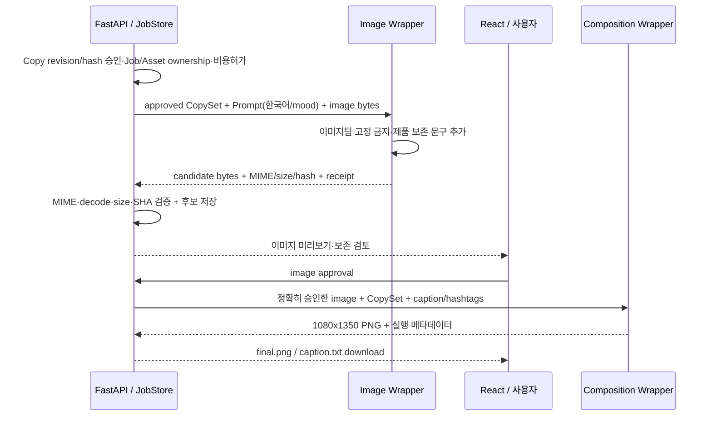

# 박지수 · Image AI + Composition 연동 패키지

> **소유:** 이미지 생성 OpenAI API Wrapper·고정 금지/보존 프롬프트·제품 외형·합성·한글 시각 품질.
> **필독:** [공통 SSOT 제6장](../../interface_spec.md), [스키마 매핑](../SCHEMA_MAPPING.md). 실제 HTTP 경로 이름은 서빙과 버전별 합의 후 결정.

> **이미지 MVP 연결 요청:** [구현 완료 범위·서빙 추가 연결·프롬프트 입력 형식·합성 예시](../../servingMvpAlignment.md)를 확인해 주세요. `feat/image-generation` 구현 기준이며, 아래 기존 계약과 구분해 남은 연결 작업을 정리했습니다.

## 1. 생성/합성의 연결 경계



## 2. Input / Output Contract

| 방향 | 필수 값 | 검증 주체 |
|---|---|---|
| 서버→이미지 | `job_id`, 승인된 `copy_revision/hash`, `AdCopyOutput.ad_copy`, 사진 asset ID + **바이트**, `ImagePromptOutput{concept,prompt,mood}` | 서빙이 owner·approve 확인; 이미지팀이 모델 입력 한도 검증 |
| 이미지팀 내부 | 타사 로고·워터마크·라벨/용기 변조 금지, 새 글씨 임의 삽입 제한, 원본 보존 문구 | 이미지팀 고정 프롬프트 버전 관리 |
| 이미지→서버 | 1개 생성 후보의 **실제 bytes**, MIME, width, height, SHA-256, mock/live, provider/model/usage/error/attempt | 서빙은 파일 바이너리 실검사·원자 저장 |
| 서버→합성 | **사용자 승인 이미지** 바이트+해시, **사용자 승인 카피** 구조·해시, layout safe-zone | 서빙 입력 매칭·승인 확인 |
| 합성→서버 | **1080×1350 PNG** (4:5), UTF-8 caption·hashtags, 실제 파일 바이트 | 서빙은 PNG/크기/해시·다운로드 QA |
| 사람 QA | 로고·라벨·용기·색·문구 가독성, 관련 광고 주장 검토 | 이미지팀+PM 공동 검수, 기술적으로 성공한 호출과 구분 |

**텍스트 프롬프트 규칙:** 입력 `ImagePromptOutput.prompt`는 **한국어**. 텍스트 v0.5에는 `negative_prompt`가 없고 금지 지시는 이미지팀이 고정으로 추가한다. `concept`와 `mood`는 AdPlan의 값을 그대로 전달. 기존 서빙 `VisualBrief.prompt_en`을 그대로 사용하면 계약이 달라짐 — Mapper 필요.

## 3. 4:5 Safe Zone·카피 배치 실험

```text
1080 × 1350 최종 캔버스
┌───────────────────────────────────────┐
│ 외곽 최소 여백 = 캔버스의 각 변 5%      │
│   ┌───────────────────────────────┐   │
│   │ 콘텐츠 배치 가능 영역          │   │
│   │ x: 0.05..0.95                 │   │
│   │ y: 0.05..0.95                 │   │
│   │ 제품/로고/라벨 가림은 별도 QA  │   │
│   └───────────────────────────────┘   │
└───────────────────────────────────────┘
```

위 여백은 **고정 텍스트 상자**가 아니다. headline/subline/CTA 글자 수, 한글 폰트, 라벨과 겹침, 배경과 텍스트 대비를 실험으로 결정한다.

| 실험 | 비교 | 전달할 결과 |
|---|---|---|
| 모델 내부 텍스트 합성 vs 후처리 레이어 | 비용, 한글 오류율, 글자 위치 자유도, 수정 가능성 | 추천안 + 한계 + 실제 원가 |
| 길이·폰트 | 헤드/서브/CTA 짧음·김·줄바꿈 | 실측별 최대 글자 수 범위, 초과시 자르기/재생성 근거 |
| 제품 원형 보존 | 라벨·브랜드명·뚜껑·패키지 형태, 투명·반투명 제품 | 원본/후보 이미지 사람 평가표 (pending/pass/fail) |
| 입력 사진 한도 | 2–5장 + 선택 참고 0–5장의 provider 허용 제약 | Wrapper 실제 지원 조건과 대체 전략 |
| 실패·비용 | rate limit·timeout·응답 유실·duplicate call | 비용/재호출/저장 동작 증빙 |

## 4. 인계 산출물과 완료 조건

- [ ] 실제 이미지/합성 Wrapper **경로·SHA·함수 signature**·입력/출력 DataClass/Pydantic 모델.
- [ ] 1건 **Fake Provider** 바이트·`sha256`·MIME/크기·오류 Fixture, 실제 저장 없이 독립 검증.
- [ ] PM 승인한 제한적 Live 1회(가능하면)와 usage/실비용 로그. 승인 전 실제 유료 호출 금지.
- [ ] 최종 PNG 1080×1350, caption/hashtags, 원본 대비 보존 체크리스트 및 한글 짧음/김 두 케이스.
- [ ] 후보 수정/중복 요청·429/timeout/unknown 과금 시 자동 재실행 **0**.
- [ ] 모델 내 텍스트 합성 vs 별도 레이어 비교 결과. 합성 정책은 실험 후 결정 로그로 등록.

`ImageResult` 바이트 무결성 검사와 제품 원형 보존 판단은 **별개의 통과 조건**이다. 이미지 Wrapper 자체는 JobStore 상태를 바꾸거나 승인 없는 생성 호출을 허용하지 않는다.

**개정 감사 P0 Wire:** [통합 계약 제2.4~2.7장](../../interface_spec.md)의 신규 7개 후보는 모두 **BLOCKED_WIRE**이며, [기계 판독 예시](../examples/wire_proposals.json)는 실제 FastAPI 경로가 아니다. 출처·승인·실행 오해 없이 담당 Wrapper Fake 테스트만 가능하다.
