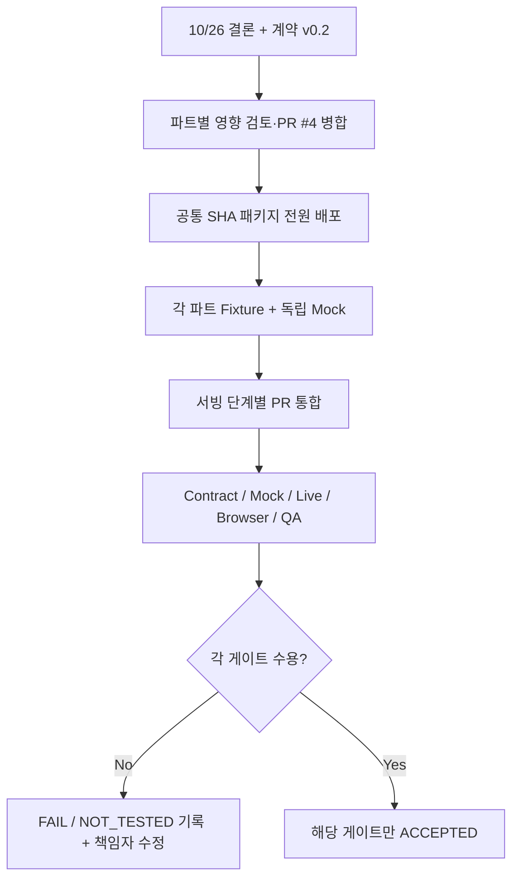

# 이태민 · PM / QA 연동·승인 패키지

> **역할:** 10/26 회의 결정을 공식 문서와 병합 순서에 반영하고, 파트별 호환성과 데모 수용 기준을 **증빙 단위로 승인**한다.
> **공통 필독:** [SSOT](../../interface_spec.md) → [C-01~C-12](../DECISION_REGISTER.md) → [로드맵](../IMPLEMENTATION_PLAN.md).

## 1. 이번 주 우선 결정·진행

| 순서 | 승인·추적 항목 | PM이 확인할 증거 |
|---|---|---|
| 1 | **PR #4 문서 계약 v0.2** 팀원 의견 확인/병합 | 10/26 합의·실험 보류 구분, M1~M5 기능 축약 누락 없음 |
| 2 | 팀 전체 공통 패키지 **같은 커밋 SHA 배포** | [배포 공지](../TEAM_DISTRIBUTION.md)·담당자별 문서 링크 |
| 3 | 텍스트 `schemas.py v0.5` 실물 수합 | 김다혜 owner/repo path/commit, Pydantic Schema 및 Fake Fixture |
| 4 | 이미지 Wrapper 실물·실험 계획 수합 | 박지수 signature/지원 사진·비용/품질/합성 방식 실험 |
| 5 | 누적 feature 병합 순서 확정 | `dev=d5d07aa` P1만 반영, P2→Stage3 diff/PR 회귀 |
| 6 | **팀 총 $10** 실험 예산 모니터링 | 실제 provider/model별 비용·사용량·승인 기록 |
| 7 | 10/30 E2E 수용 항목 기록 | Contract/Mock/Live/Browser/규제/이미지·보안 **서로 다른 판정** |

## 2. 수용 기준·판정 기록 표

| 게이트 | 담당 확인 | PASS 조건 | 초기 판정 |
|---|---|---|---|
| **Contract** | 김다혜·이형기·권혁상 | 실제 v0.5 스키마 ↔ HTTP/TS/Fixture 무손실 검증 | NOT_TESTED |
| **Mock E2E** | 이형기 | 업로드·카피/이미지 2회 승인·409·1080×1350 PNG | 기능 브랜치 P3~M5 PASS |
| **Live Text** | 김다혜+서빙 | VLM/검색 URL/추론 구분, 규제/카피 비용 | NOT_TESTED |
| **Live Image+Composer** | 박지수+서빙 | 이미지 바이트·제품 라벨·한글·4:5·사용자 승인 | NOT_TESTED |
| **React Browser** | 권혁상+서빙 | 실제 사용자 업로드→조사/경고→승인→다운로드 | NOT_TESTED |
| **Cost/Security** | 이태민+서빙 | $10 차단, 중복/429/timeout, 인증/키·CORS/HTTPS | 미완성 |
| **Ad/Product QA** | 텍스트·이미지·PM | 위반 의심 차단·대안·원본 로고/라벨 확인 | NOT_TESTED |

기록마다 **commit SHA, 테스트일, owner, 재현 스크립트/로그, 실제 비용, 판정(`PASS`/`FAIL`/`NOT_TESTED`)**을 남긴다. 기존 **118 passed**는 `f979331` 레거시 기능 감사일 뿐 **새 v0.2 Live/React E2E 승인 근거가 아니다.**

## 3. 미결정·실험 항목의 처리

| 범위 | 상태 | 규칙 |
|---|---|---|
| 카피 headline/subline/cta 배치·최대 길이 | 실험 대기 | 박지수 한글/레이아웃·비용 실험 후 변경 결정 |
| 모델 이미지 안에 문구 생성 vs 후처리 레이어 | 실험 대기 | 이미지/QA 근거 없이 고정 금지 |
| 비화장품 처리 UX·동일 제품/세트 | 고도화 | 현재 MVP에 신규 상태·필수 기능 임의 추가 금지 |
| 카피 거절 후 수정/재승인 | 고도화 우선 | 기존 terminal 상태 당분간 유지 |
| 신규 public endpoint·오류 DTO | 구현 전 | 서빙 OpenAPI와 영향 파트 리뷰 후 버전 갱신 |
| 10/30 Live/Mock 필수 조합 | 인수 범위 구체화 필요 | 기대값/비용/보안 확보 상태를 투명하게 판정 |

## 4. 팀 운영·PR 리뷰 체크리스트

- [ ] 계약 변경: C-ID, 이전/변경값, owner/reviewer, schema/API/React/Fixture/비용·보안 영향.
- [ ] 문서 PR 먼저 병합; 모델 파트는 독립 wrapper·Pydantic/Fake 테스트 진행.
- [ ] `feat/p4-contract-handoff` 누적 이력 안전 처리. 이미 병합된 P1과 중복 커밋/기능 반영 금지.
- [ ] Live 예산/키 보호 승인, 비용 상한 초과 **사전 승인** 없으면 provider 호출 금지.
- [ ] 승인 후 공식 버전/commit 링크만 배포, 오래된 회의 v0.1 PDF·채팅 복사본을 별도 SSOT로 사용하지 않음.
- [ ] `dev` 코드 미구현 API를 현재 서비스 사용 가능하다고 보고하지 않음.

**의견 요청은 GitHub PR의 구체적 줄/코멘트 또는 결정 레지스터 ID로 접수**해 비동기적으로 수렴한다. 추가 전체회의를 원칙적 개발 선행조건으로 삼지 않는다.

**개정 감사 P0 Wire:** [통합 계약 제2.4~2.7장](../../interface_spec.md)의 신규 7개 후보는 모두 **BLOCKED_WIRE**이며, [기계 판독 예시](../examples/wire_proposals.json)는 실제 FastAPI 경로가 아니다. 출처·승인·실행 오해 없이 담당 Wrapper Fake 테스트만 가능하다.
