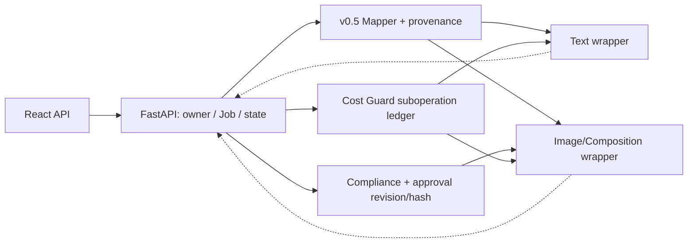
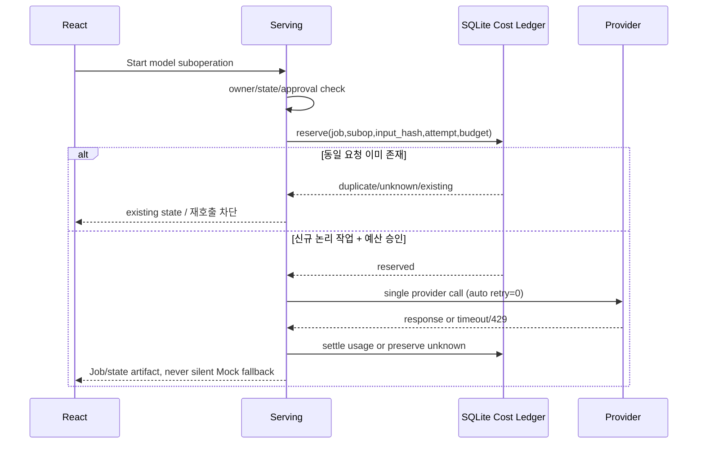

# 이형기 · FastAPI / Backend / Infra 연동 패키지

> **소유:** HTTP wire·JobStore·자산/승인·스키마 mapper·비용 원장/중복 호출·VM 보안·단계별 E2E 증거.
> **필독:** [통합 계약](../../interface_spec.md) · [매핑표](../SCHEMA_MAPPING.md) · [Git 병합계획](../IMPLEMENTATION_PLAN.md).

## 1. 보존할 기존 코드와 변경 사항

| 코드/기능 | 기존 feature 상태 (`f979331`) | 10/26 이후 서빙 작업 |
|---|---|---|
| `/jobs`·`job_store.py` | 업로드·파일 검증·원자 Job 기록 | 확장 ProductInput, 안전한 리사이즈, VLM/Compliance/Prompt/approval hash 저장 |
| `/mock/*` | 9개 상태·2회 승인·최종 1080×1350 PNG | Mock E2E 회귀 절대 훼손 금지 |
| `/ai/plan`·`ai/copy` | OpenAI wrapper 준비, 검색/CostGuard 미연결 | 김다혜 모델 wrapper·검색/검수로 연결 / Live 이전 비용 보호 |
| `provisional_contracts.py` | 7 DTO + 7 Fixture + OpenAPI/Schema exporter | 실제 `schemas.py v0.5`를 **무손실 호환 mapper**로 수용 |
| `p4_research_adapter.py` | Fake 검색 결과 normalize/검증 | OpenAI 실제 인용 출처와 구형 Evidence 처리 호환 |
| `p4_image_adapter.py` | Fake 이미지 bytes·MIME·hash 검증 | 박지수 wrapper·승인 hash·HTTP·Composition 연결 |
| `p4_cost_guard.py` | SQLite `(job_id,stage)` 단위 예약 | `suboperation` 별 호출 허용, 동일 요청 중복 차단·$10 budget |
| `audit_p4_handoff.py` | 13 API/9 status/7 Fixture/Manifest 감사 | 신규 v0.5/HTTP/TS 검증과 함께 보존 |

### 현재와 목표를 혼동하지 않는 실행 구조



## 2. Job·Artifact 및 승인 트랜잭션 계약

1. **Upload:** multipart 제품 2–5장/참고 0–5장 → MIME/디코딩/중복/손상 검사 → owner가 일치하는 asset ID → Job. UI 무제한 정책은 자동 축소/압축으로 해결하지만 해체 폭탄·메모리·요청 제한 없는 서버는 금지.
2. **VLM:** 사진 바이트 검증 후 김다혜 Wrapper `ProductAnalysis`. `is_cosmetic=false` 결과 저장/후속 중단 정책은 별도 wire 설계. 라벨 판독은 AI 추론.
3. **Research:** OpenAI 실제 `url_citation`과 `research_performed`/`display_summary`를 보존. 검색 실패→AI 추론 명확.
4. **Copy:** 구조 `AdCopyOutput`와 `ComplianceReport` 전체 저장, 자동 대체 문구 사용 시 검수 대상 해시 명확화.
5. **Approval:** `passed=false` **서버 차단**, user/copy revision/hash 기록. 카피 변경/재생성 시 승인 무효화. 기존 Boolean만으로 Live 이미지 허가하지 않음.
6. **Image:** 승인된 카피·자산 owner·budget→이미지팀 Wrapper→실제 bytes/MIME/치수/sha 검증→원자 저장→사용자 이미지 승인.
7. **Composition:** 정확히 승인한 image/copy를 이미지팀에 보내 1080×1350 PNG/caption 생성, 다시 바이너리 검사 후 다운로드 등록.

## 3. 비용 멱등성·장애 처리



| 실패 | 강제 조건 | 테스트 |
|---|---|---|
| 같은 Job에서 **다른** 검색·기획·검수 호출 | 서로 다른 suboperation 허용 | 각각 Fake 호출 1회 |
| 같은 Job/같은 입력 **동일 요청 재전송** | 기존 상태 조회, 중복 과금 호출 0회 | 연속·동시 호출 |
| provider 429/timeout/응답 유실 | `billing_state=unknown`, 예약 보존, SDK retry 0 | provider call count |
| 비용 예상/실제 | 추정 예약과 청구금액 분리, **팀 $10** gate | 잔액 부족 시 provider calls 0 |
| Live flag만 활성 | 키·승인모델·예산·ledger 미충족이면 fail-closed | 503/명시적 실패 |
| 예기치 않은 상태/asset ownership | 결과 변경/유료 호출 전 차단 | 409 또는 합의 오류계약 |

호출 초기 설정 timeout **300초**, output **1200 tokens**. 동일 단계 내부 연산 횟수 자체를 임의 3회로 제한하지 않는다. 필요시 비용 및 품질 실험에 기반해 결정한다.

## 4. Git·API 계약 동기화

```text
현재 dev: d5d07aa = P1 health
기능 누적: 3f80c85(P2) → 2ba82ac(P3) → 9d5dbc7(P4A)
         → fa2c597(Stage1) → eb8a512(Stage2) → f979331(Stage3)
```

- 문서 PR #4 병합 후 P2부터 feature diff 확인/순차 통합. 다른 팀이 누적 feature를 독립 PR로 중복 합치지 않도록 안내.
- **정식 schema:** 실제 김다혜 `schemas.py v0.5` path/commit/hash 확보 → Pydantic validation/JSON Schema → server Mapper/fixtures → FastAPI endpoint → `/openapi.json` → TS 타입 → Browser E2E.
- 새 VLM/Compliance/image/compose endpoint·body·오류·상태는 [SSOT 9장](../../interface_spec.md)의 미결정 목록에 포함. **임의 API 이름을 확정하지 않는다.**
- 공통 `main.py`, `job_store.py`, 계약서 충돌 변경은 서빙 통합 담당 주관. force push/direct dev/main push 금지.

## 5. E2E 인수 테스트 (예시)

| 구분 | 필수 Positive | 필수 Negative |
|---|---|---|
| 파일 | 정상 2–5 + 0–5, 선별 축소 | 손상/중복/압축폭탄/권리 체크 없음 |
| 스키마 | v0.5 round-trip, `display_summary`·citation | 누락 필드, fake citations, source 오표기 |
| Compliance | passed=true 카피 승인 | passed=false **서버에서 승인 거부** |
| Approval | 정확한 copy/image hash·actor | 구 revision/조작 이미지/미승인 합성 |
| Cost | 다른 suboperation 정상 허용 | 동일 요청 duplicate, timeout unknown, $10 초과 차단 |
| Mock | 9 status, 2 approvals, final PNG | 승인 전 409, 503 한글 폰트 누락 |
| Live/Brower | 모델별 제한 호출·실제 React 업로드/다운로드 | Live 실패를 Mock PASS로 표시하지 않음 |

**환경 경계:** GCP VM `team2-vm` 무승인 중지·재부팅 금지. 인증/HTTPS/CORS 확정 전 8000 public 금지. 서버 키/민감 사진 Git 미포함. 기존 단일 worker JobStore/SQLite를 다중 worker 안전 서비스로 광고하지 않는다.

**개정 감사 P0 Wire:** [통합 계약 제2.4~2.7장](../../interface_spec.md)의 신규 7개 후보는 모두 **BLOCKED_WIRE**이며, [기계 판독 예시](../examples/wire_proposals.json)는 실제 FastAPI 경로가 아니다. 출처·승인·실행 오해 없이 담당 Wrapper Fake 테스트만 가능하다.


## 6. P0-04 — 서버 소유 검수 기록과 원자적 카피 승인 (후속 PR 필수)

세부 필드·지문 생성 범위는 **[SSOT §3.2](../../interface_spec.md)**를 따른다. `canonical_copy_hash(AdCopyOutput)`와 `review_input_sha256(실제 검수 맥락)`는 다르다.

| 서버 단계 | 소유 위치·필수 구현 | 인수 부정 테스트 |
|---|---|---|
| 검수 입력 스냅샷/Job 판본 기록 | `job_store.py`에 copy revision·불변 입력·기준 Job version을 영속화 | 같은 revision 다른 카피, 검수 중 context/제품 주장 변경 |
| 신뢰 가능한 검수 실행·결과 수신 | 실제 텍스트 Owner Wrapper 호출 결과만 backend가 correlation ID로 수령·검증; **HTTP 사용자가 기록 생성 불가** | 재사용된 report, 조작 report hash, 검수 수행되지 않은 record ID |
| 검수 결과 영속·무결성 | 서버 저장소의 `review_record_id`·report/input hash·rule/model/schema version + audit metadata | T-03 새 hash+옛 report, T-04 제품명 변경, 원본 user_text 변경 |
| Copy 승인 원자 처리 | `job_api.py`/현재 승인 라우터 + JobStore의 **상태/권한/job version/review hash/passed 비교·승인 기록 저장을 하나의 트랜잭션**으로 묶음 | 다른 Job record, stale/missing/failed review, 경합·중복 승인, TOCTOU |
| 실패/재시작 복구 | 승인·보고서 저장/검수 job 중간 단계 crash 복구와 receipt 불확실 상태 추적 | 프로세스 재시작 후 이전 승인/검수 복원, 결함 시 호출 0 |
| HTTP/FE 계약 | PM+React+서빙 합의 후 정확한 409/error body 및 TS 타입/Fixture 생성 | 승인 전 이미지 호출 0, 정상/실패 OpenAPI, Browser E2E |

**실행 구분:** `ReferenceReviewLedger`의 단일 프로세스 `RLock`/메모리 저장은 **원자성 참조 예제**일 뿐, legacy JobStore 파일 쓰기/멀티 worker/인증 안전성을 입증하지 않는다. 기존 서버 `ReviewRequest.approved: bool`는 그대로이며 본 PR에는 실제 운영용 검수 기록 저장 또는 승인 게이트를 추가하지 않았다. **Owner 공식 스키마와 입력 scope, 실 저장소 트랜잭션 설계 및 PM Wire 승인 전 Live 경로에 연결 금지.**
