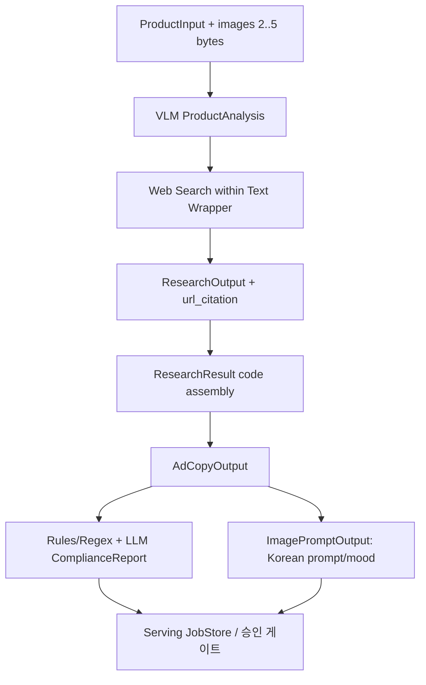

# 김다혜 · Text AI / VLM / Research / Copy / Compliance 연동 패키지

> **계약 소유:** 텍스트 `schemas.py v0.5`의 필드·Literal·모델 실행 품질. **서빙에서 이에 맞추어 호환성을 구현**한다.
> **필독:** [공통 SSOT 제4장](../../interface_spec.md) · [스키마 매핑](../SCHEMA_MAPPING.md).

## 1. 단계별 입력·출력·검증 계약

| 단계 | 입력 | 출력 / 검사 |
|---|---|---|
| VLM | 서버가 확인한 제품 사진 2–5장 **바이트** + `ProductInput` | `ProductAnalysis` (화장품 여부, 종류·용기·색·라벨·mood·투명도), is_same_product는 없음 |
| Research | ProductInput + ProductAnalysis + 검색 컨텍스트 | `ResearchOutput`(LLM), `ResearchResult`(코드 조립·실제 citations·research_performed) |
| 기획·카피 | 검증한 조사+제품 정보 | `AdCopyOutput.plan`, `ad_copy{headline,subline,cta}`, caption, hashtags |
| Compliance | 구조화 카피·제품 정보·규제 근거 | 규칙/정규식 1차 + LLM 2차 → `ComplianceReport`(코드 조립) |
| 이미지 프롬프트 | AdCopyOutput.plan + 승인 가능한 카피 | `ImagePromptOutput`(한국어 prompt, concept, mood) — negative_prompt 없음 |



## 2. 출처·검색·검수의 필수 불변조건

| 구분 | 처리 규칙 | 부정 테스트 |
|---|---|---|
| 검색 출처 | OpenAI 응답 실제 `url_citation`의 제목/URL만 `citations`에 기록 | LLM 본문이 생성한 가짜 URL 채택 금지 |
| 출처 유형 | `사용자 입력` / `검색 결과` / `AI 추론`; **VLM 라벨 판독도 추론** | 제품 라벨 오판을 독립 검증 사실로 오인 금지 |
| 검색 실패 | `research_performed=false`; 조사 내용 전부 AI 추론; UI용 요약도 유지 | citation 없음인데 연구 완료 표시 금지 |
| 화면 요약 | 동일 ResearchOutput에서 `display_summary` 3–5줄 생성(추가 모델 요약 호출 X) | 연구 전체·요약의 source 미일치 검사 |
| 규제 판단 | `위반 의심` 하나라도 있으면 `passed=false`; `근거 확인 필요`는 경고 | false를 true로 변환하여 승인 통과 금지 |
| 하이라이트 | LLMIssue의 위험 `text`를 실제 `field` 문자열에서 찾아 `start/end` 조립 | 위치 불일치·수정 전 문자열 참조 금지 |
| 고지 | `notice`의 최종 사용자 확인 책임 문구 보존 | 법규 준수 인증으로 표시 금지 |

### ComplianceReport 예시 (합성 데이터, 원본 headline="오늘의 피부 재생 크림")

```json
{
  "passed": false,
  "issues": [{
    "field": "headline", "text": "피부 재생", "start": 4, "end": 9,
    "category": "의약품 오인", "risk_level": "위반 의심",
    "reason": "의약품 효능 오인 우려", "suggestion": "피부 결 정돈",
    "basis": null, "detected_by": "rule", "auto_fixed": false
  }],
  "revised_fields": {"headline": "오늘의 피부 결 정돈 크림"},
  "checklist": ["제품의 실제 표시사항과 근거 확인"],
  "notice": "검수 결과는 참고용이며 법적 판단이 아닙니다. 게시 전 최종 확인 책임은 사용자에게 있습니다."
}
```

## 3. Wrapper ↔ Serving 연계에 필요한 코드 계약

1. **실제 `schemas.py v0.5` 파일 경로·commit SHA·Pydantic Schema Export**. 공유된 회의 코드 텍스트와 구현을 동일한 것으로 단정하지 않는다.
2. 실제 import 가능한 Fake Wrapper와 Live Wrapper. Python 함수 signature, 입력 바이트 타입·사진 개수, 각 반환 DTO와 모델/usage/errors를 별도 제공한다.
3. LLM Structured Output 대상은 `ProductAnalysis`, `ResearchOutput`, `AdCopyOutput`, `ImagePromptOutput`, `LLMIssue`. `ResearchResult`·`ComplianceReport`는 **코드 조립**임을 유지한다.
4. 텍스트 내부 검색/기획/카피/검수 등 순차 호출은 `suboperation`, 동일 요청 식별 hash·attempt, provider billing state를 기록할 수 있어야 한다. 현행 서빙 `(job_id,stage)` 단일 예약과 맞지 않는다.
5. 초기 모델 호출 설정: timeout **300s**, max output **1200 tokens**, SDK auto retries **0**. Structured Output 잘림·검색 지연·429·timeout을 Fake로 시험하고 결과 보고.
6. `ImagePromptOutput.concept/mood`는 AdPlan과 동일, `prompt` **한국어**. 이미지팀의 고정 금지 프롬프트를 텍스트팀에서 이중 삽입하지 않는다.

## 4. 전달 요청·완료 증거

- [ ] Pydantic v0.5 원본 경로/커밋, Schema 7종 이상·검증 스크립트 (정확한 개수는 실제 export로 판정).
- [ ] ProductInput / ProductAnalysis / ResearchResult / AdCopyOutput / ImagePromptOutput / ComplianceReport 정상 Fixture 및 **실패 Fixture**.
- [ ] 실제 citations/검색 실패 → AI 추론/사용자 입력/화장품 아닌 사진 테스트.
- [ ] `ComplianceReport` 위반 의심·근거 확인 필요·auto_fixed·하이라이트 UTF-8 검증.
- [ ] 모델 ID, 요청 수, 토큰·실제 비용 메타데이터, 민감정보 제거한 Live 호출 로그(허가 후).
- [ ] Fake Wrapper 사용 시 **모델 호출 0**·Live 성공과 분리 보고.

**비용:** 실험 포함 전체 팀 $10 제한, API Key는 서버 비밀관리, 무단 실결제 호출 금지. 텍스트 내용/프롬프트/LLM 평가 책임은 본 파트, JobStore·HTTP·승인·재시도 차단은 서빙 책임이다.

**원본 인계:** `docs/contracts/check_owner_schema.py --source <공식 schemas.py> --expected-sha256 <해시>`로 실제 Owner schema+Fixture를 검증해야 한다. 코드 스냅샷 검증만으로 공식 SHA를 추정해서는 안 된다.

**개정 감사 P0 Wire:** [통합 계약 제2.4~2.7장](../../interface_spec.md)의 신규 7개 후보는 모두 **BLOCKED_WIRE**이며, [기계 판독 예시](../examples/wire_proposals.json)는 실제 FastAPI 경로가 아니다. 출처·승인·실행 오해 없이 담당 Wrapper Fake 테스트만 가능하다.
