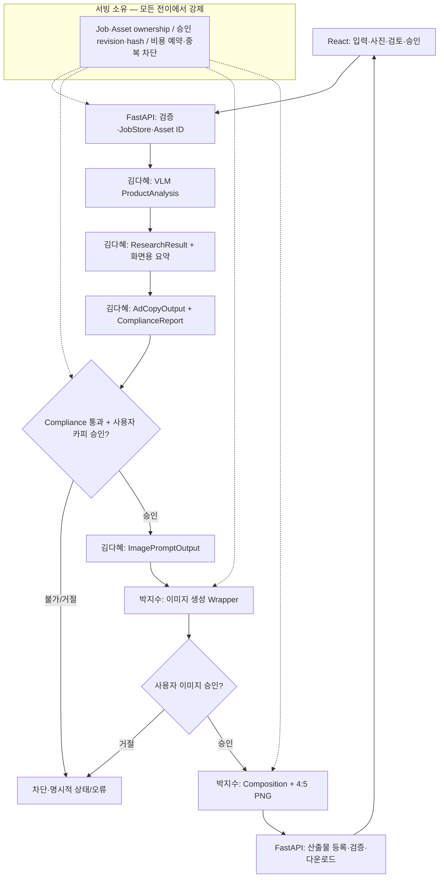
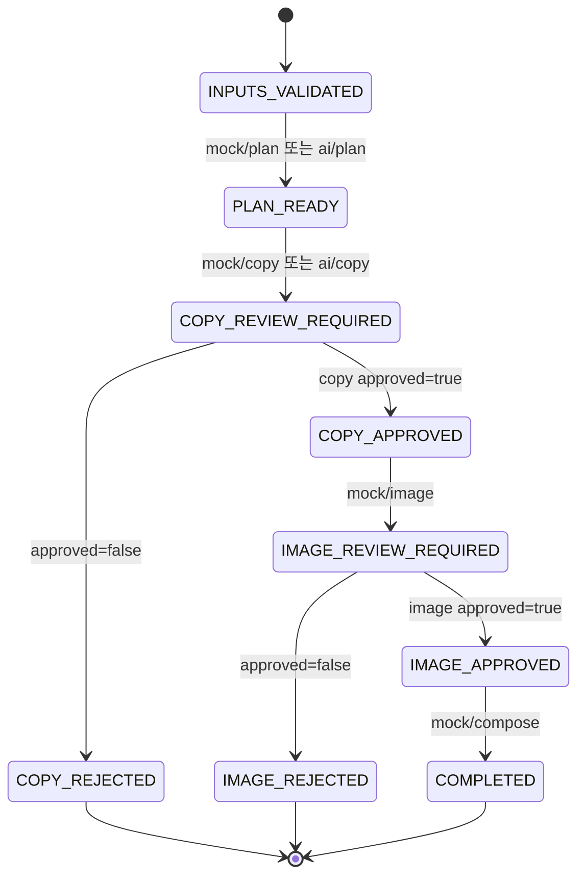
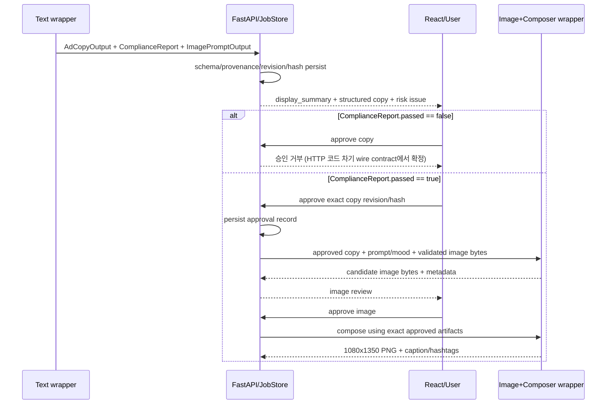
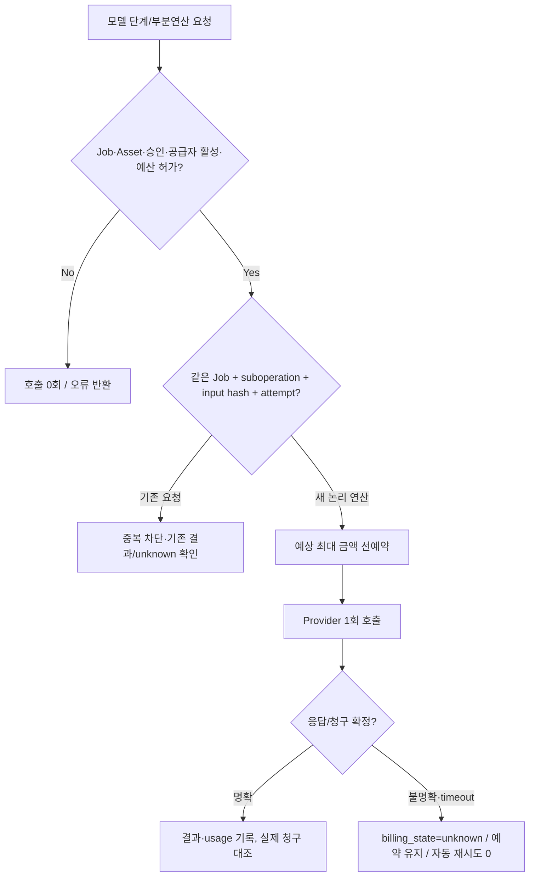

# IT-TEM 통합 API·모델 어댑터 계약 v0.2

| 항목 | 검토 기준 |
|---|---|
| 계약 버전 / 날짜 | **v0.2** · 2026-10-26 PM 참석 회의 · 1차 E2E 목표 10/30 |
| 적용 상태 | **PR #4 리뷰 중**: 병합 전 회의 반영안, 병합 후 공식 SSOT |
| 텍스트 스키마 | 김다혜 **v0.5**. 회의 공유 코드 스냅샷으로 합성 Fixture 7개 Pydantic 검증 PASS. **실제 팀 저장소 path/SHA 미확인** |
| 구현 기준 | `dev=d5d07aa`는 P1 health만; `f979331`에는 레거시 13개 API·118 회귀 통과, **dev 미병합** |

**적용 규칙.** 이 문서는 *파트 간 의미·책임·완료 기준*을 규정한다. 기존 코드의 API 동작, 팀 회의에서 확정한 규칙, 구현 전 목표를 구분하며, 여기에 적힌 신규 인터페이스가 이미 동작한다고 암시하지 않는다. 기술 이력은 [M1~M5 통합·병합 계획](contracts/IMPLEMENTATION_PLAN.md), 회의 결정·보류는 [결정 레지스터](contracts/DECISION_REGISTER.md), 담당자별 작업은 [배포 인덱스](contracts/README.md), 상세 필드 매핑은 [스키마 매핑표](contracts/SCHEMA_MAPPING.md)를 참조한다.

| 표시 | 의미 | 배포·개발 시 해석 |
|---|---|---|
| **LEGACY-IMPLEMENTED** | `f979331` feature에 실제 코드·테스트가 있음 | `dev`에 병합되기 전에는 배포 사용 불가 |
| **INTERNAL-READY** | DTO/Port/Fake 테스트 준비, 공개 HTTP에 미연결 | 동작하는 Live API 아님 |
| **DECIDED / TO-IMPLEMENT** | 10/26 회의에서 방향 결정, 코드·HTTP는 아직 미반영 | 구현 PR과 계약 테스트 필요 |
| **EXPERIMENT / DEFER** | 실험 후 결정 또는 고도화 이관 | 현재 합의·구현 완료로 표기 금지 |

---

## 1. 제품 범위·사용자 산출물

| 항목 | 10/26 기준 계약 | 판정 |
|---|---|---|
| 대상 | 단일 화장품 제품·인스타그램 **피드용 이미지 한 장** | DECIDED |
| 입력 사진 | 제품 사진 **2–5장**, 배경 참고 **0–5장** | DECIDED |
| 추가 입력 | `ProductInput`: 제품명·특징·광고 목적·기능성 여부·사진 사용권한 체크; 브랜드명·카테고리는 nullable | DECIDED |
| 과정 | 업로드→**VLM 화장품 판별**→사전 조사·기획→구조화된 카피·규제 검수→카피 승인→이미지→이미지 승인→합성 | DECIDED |
| 화면 | 조사 요약·검색 출처/AI 추론, 카피·캡션·해시태그, 규제 위험 위치·대안·책임 고지 | DECIDED |
| 다운로드 | 승인 이미지 기반 **1080×1350 PNG**, UTF-8 게시글 캡션·해시태그 | DECIDED |
| 제외 | 자동 게시, 릴스/캐러셀, 복수 후보 탐색, 법규 완전 보증, 대규모 논문/브라우저 에이전트 | 범위 외 |
| 고도화 | 동일 제품·세트 검사, 비화장품 처리 최종 UX, 카피 거절 후 편집·재승인 | DEFER |
| 실험 | 헤드/서브/CTA의 배치·길이 제한·모델 내 텍스트 합성 vs 별도 텍스트 레이어 | EXPERIMENT |

### 1.1 실행 흐름·승인 경계



**소유권 불변조건:** AI Wrapper는 DTO/바이트/사용량·오류 정보를 반환한다. 모델팀 코드는 `JobStore`와 서버 승인 상태를 직접 변경하지 않는다. 서버는 후속 호출 **전에** Job 상태, 자산 소유권, 승인된 정확한 입력, 과금 허가를 점검한다.

### 1.2 파트별 RACI·데이터 인계

| 경계 / 데이터 | 제공·품질 책임 | 서빙 책임 | React·PM 검증 |
|---|---|---|---|
| React→Upload `ProductInput` + 바이트 | 권혁상: 폼·권한 고지 | 이형기: 검증·저장·asset_id | PM: 입력·파일 정책 |
| Upload→VLM `ProductAnalysis` | 김다혜: 화장품 분석·VLM 결과 | 바이트 전달·결과 저장 | React: 비화장품 결과 처리(정책 세부 대기) |
| VLM→Research `ResearchResult` | 김다혜: 검색, 인용 추출, 조사 요약 | 출처·AI 추론 별도 표시·보존 | React: 요약/인용 표시 |
| Research→Copy `AdCopyOutput` | 김다혜: 기획·카피·caption/hashtags | 구조·revision/hash 보존 | React: 승인 대상 표시 |
| Copy→Compliance `ComplianceReport` | 김다혜: 규칙+LLM 위험 검수 | 위험 통과 전 승인 거부 | React: 하이라이트·대안·고지 |
| Copy→Image `ImagePromptOutput` + 사진 | 김다혜: 한국어 prompt/mood; 박지수: 고정 금지·보존 조건 | 승인 copy·이미지 자산 매핑 | PM: 제품 보존 기준 |
| Image→Composition | 박지수: 이미지 바이트·합성·4:5 | 무결성·이미지 승인·파일 등록 | React: 이미지 검토/다운로드 |
| Budget & Delivery | 모델팀: usage·오류·모델 버전 | 이형기: 예약·실청구 상태·통합 | 이태민: 예산·키·브랜치 승인 |

---

## 2. React ↔ FastAPI: 기존 공개 HTTP 계약과 차이

**공통:** 접두어 `/api/v1` (단, `GET /health`는 루트), 필드 `snake_case`, 성공 응답은 **직접 Job JSON 또는 파일 바이너리**, 공통 `{data:...}` 래퍼 **없음**. `GET /openapi.json`은 해당 서버에서 *실제 구현된* HTTP의 기준이다. 아래 경로의 코드는 **`f979331` 기준**이며 `dev` 서버에서 사용 가능하다는 뜻이 아니다.

### 2.1 레거시 공개 13개 경로 (feature 구현·검증)

| 메서드 | `/api/v1` 이하 경로 | 입력·응답/상태 | 구분 |
|---|---|---|---|
| POST | `/jobs` | `multipart/form-data` → **201 Job** | LEGACY-IMPLEMENTED |
| GET | `/jobs/{job_id}` | 현재 Job(JSON) | LEGACY-IMPLEMENTED |
| GET | `/jobs/{job_id}/assets/{asset_id}` | 업로드 이미지 바이너리 | LEGACY-IMPLEMENTED |
| POST | `/jobs/{job_id}/mock/plan` | `{"brand_name":"...","product_name":"..."}` → `PLAN_READY` | LEGACY-IMPLEMENTED |
| POST | `/jobs/{job_id}/mock/copy` | 본문 없음 → `COPY_REVIEW_REQUIRED` | LEGACY-IMPLEMENTED |
| POST | `/jobs/{job_id}/approvals/copy` | `{"approved":true} 또는 {"approved":false}` → 승인/거절 | LEGACY-IMPLEMENTED |
| POST | `/jobs/{job_id}/mock/image` | 본문 없음 → `IMAGE_REVIEW_REQUIRED` | LEGACY-IMPLEMENTED |
| POST | `/jobs/{job_id}/approvals/image` | `{"approved":true} 또는 {"approved":false}` → 승인/거절 | LEGACY-IMPLEMENTED |
| POST | `/jobs/{job_id}/mock/compose` | 본문 없음 → `COMPLETED` | LEGACY-IMPLEMENTED |
| GET | `/jobs/{job_id}/artifacts/{kind}` | `plan`,`copy`,`image`,`final`,`caption` 바이너리 다운로드 | LEGACY-IMPLEMENTED |
| GET | `/capabilities` | 사용 가능 모드·provider 준비정보 | LEGACY-IMPLEMENTED |
| POST | `/jobs/{job_id}/ai/plan` | `brand_name`, `product_name`, `product_facts[]` → Job | LEGACY-IMPLEMENTED; 실제 검색 미연결 |
| POST | `/jobs/{job_id}/ai/copy` | 본문 없음 → Job | LEGACY-IMPLEMENTED; 실과금 미검증 |

`/mock/*`는 첫 제품 사진을 Pillow로 배치하는 **모의** 생성이며 제품 사진 2–5장 기반 실모델 결과가 아니다. `/ai/plan`은 검색을 수행하지 않고 `research_performed=false`로 처리한다. `/capabilities`의 설정 준비 상태는 실제 검색·광고 적법성·품질을 보증하지 않는다.

**제안이지만 현재 구현되어 있지 않은 경로:** `/jobs/{job_id}/ai/image` 및 `/jobs/{job_id}/compose`. VLM 분석, 조사 요약, Compliance, 승인 revision, 실이미지·합성에 필요한 새 HTTP **메서드·본문·응답·상태값은 후속 구현 PR에서 OpenAPI·예제와 함께 확정**해야 한다. 새 경로가 이 문서에 서술되었다는 이유로 구현 완료로 간주하지 않는다.

### 2.2 업로드·Job·Artifact 현행 구현과 10/26 변경

| 항목 | `f979331` 구현 값 | 10/26 방향 / 실행 영향 |
|---|---|---|
| 제품·참고 | `product_images` 2–5, `reference_images` 0–5 (반복 필드) | 장수 유지; 실제 `ProductInput` 건수와 교차 검증 필요 |
| 허용형식 | PNG/JPEG/WEBP; MIME/디코딩 일치 검사 | 보안 검사 유지, 이미지 전처리 단계 추가 |
| 업로드 제한 | 파일당 **10MiB**, 전체 **60MiB**, 이미지당 **40MP** | 사용자 UI 정책은 일반 사진 크기 제한 없이 **큰 이미지 자동 축소·압축**. 안전한 물리적 상한·전처리 세부는 구현 결정 필요 |
| 부정 입력 | 빈 파일·손상·애니메이션·중복 SHA 거절 | 우회·메모리 폭증 방지 유지 |
| Job/Asset ID | 각각 소문자 32자리 hex | 내부 식별자 유지 여부는 마이그레이션에서 확인 |
| 저장소 | `.runtime/jobs/<job_id>/`, 원자적 `job.json` 기록, 단일 worker 전제 | AI 중간 DTO, revision·provenance·usage 영속 필드 추가 필요 |
| 보안 | 인증·인가/HTTPS·CORS/retention 미완 | GCP 8000 외부 직접 공개 금지 |

**현재 Job 부분 예시 — 합성 데이터, 실제 실행 결과가 아님:**

```json
{
  "job_id": "11111111111111111111111111111111",
  "status": "INPUTS_VALIDATED",
  "created_at": "2026-10-26T00:00:00+00:00",
  "assets": [
    {"asset_id": "22222222222222222222222222222222",
     "role": "product", "original_filename": "product_1.png",
     "content_type": "image/png", "size_bytes": 327,
     "width": 100, "height": 120,
     "sha256": "aaaaaaaaaaaaaaaaaaaaaaaaaaaaaaaaaaaaaaaaaaaaaaaaaaaaaaaaaaaaaaaa"}
  ]
}
```

실제 생성 요청은 최소 제품사진 **2장**을 요구한다. 위 JSON은 형태 설명만을 위한 부분 객체다. 단계별 추가 필드에는 `plan`, `copy_candidate`, `image_candidate`, `final_output`, `artifacts`가 존재할 수 있다. 현행 `artifacts[kind]`는 `kind`, `content_type`, `size_bytes`, `download_url` 메타데이터를 제공한다. React는 단계 후 **`GET /jobs/{job_id}`로 서버 상태를 재조회**한다.

### 2.3 현행 React 호출 예제 (feature 코드 기준)

```ts
// 현재 dev에는 /api/v1/jobs가 없음. feature가 병합되고 접근 경로 승인된 경우의 예시.
const form = new FormData();
productFiles.forEach((file) => form.append('product_images', file));
referenceFiles.forEach((file) => form.append('reference_images', file));
const response = await fetch(`${baseUrl}/api/v1/jobs`, { method: 'POST', body: form });
if (!response.ok) throw new Error(`HTTP ${response.status}`);
const job = await response.json(); // 직접 Job 응답, data wrapper 아님
```

`127.0.0.1`은 **브라우저 실행 사용자의 PC** 주소이므로 VM 개발 서버 주소로 사용 불가. 외부 접근·Vite proxy·HTTPS/인증/CORS 방침을 승인한 후 브라우저 네트워크 검증을 실시한다.

---

### 2.4 계약 상태 및 Freeze 게이트 — 공통 해석

| 표시 | 뜻 | 독립 개발 가능 범위 | 신규 공개 HTTP 호출 |
|---|---|---|---|
| **APPROVED_POLICY** | 10/26 회의의 제품·책임·예산·검수 정책 합의 | 입력·출력 의미, Fake Wrapper 개발 | **자동 승인 아님** |
| **LEGACY_IMPLEMENTED_UNMERGED** | `f979331`에 구현된 기존 13개 경로·9상태 | 해당 브랜치 HTTP Mock 테스트 | `dev` 병합 전 접근 가정 금지 |
| **FROZEN_WIRE** | 경로·method·본문·응답·오류·상태·owner를 PM/영향 파트가 승인하고 OpenAPI·Fixtures 동기화 | 구현·React SDK·정식 통합 테스트 | 해당 버전이 실제 `dev`에 반영된 뒤만 |
| **BLOCKED_WIRE** | 중요한 입력·반환·서명·승인 증거가 없어 공개 API 동결 불가 | owner의 **내부 Fake/DTO 단위 개발만** | **신규 URL 사용 금지** |
| **EXPERIMENT** | 합성 방식·카피 길이·모델 입력 제약 | 격리 실험, 비용 승인 필요 | 결과를 정식 계약에 자동 반영 금지 |
| **DEFER** | 동일 제품 검증·거절 후 재승인 등 | 후속 버전 | MVP 필수 요구로 승격 금지 |

**2026-10-27 기준 신규 FROZEN_WIRE는 0개.** PR #4의 **정책 승인**은 API·타입 **기술 동결**을 대신하지 않는다. 각 FROZEN_WIRE에는 결정 ID, 승인자·시각, owner code SHA, 계약 Fixture, OpenAPI와 TS 검사 증거가 반드시 필요하다. 아직 미제공된 텍스트팀 공식 소스·이미지 Wrapper가 있다는 가정으로 계약을 동결하지 않는다.

### 2.5 신규 동작 후보 — HTTP Wire 결정표

아래 경로는 **실제 구현 경로가 아니라 논의용 경로명 PROPOSAL**이다. 구조화한 정상·실패 요청/응답 예제 7종은 [`examples/wire_proposals.json`](contracts/examples/wire_proposals.json)에서 조회한다. JSON 전체를 파싱할 수 있지만, **현재 FastAPI OpenAPI나 React SDK의 타입이 아니다**.

| ID·단계 | 제안 method 및 `/api/v1` 이하 경로 | 입력 → 출력 후보 | 상태·오류 후보 | 결정 Owner / 필요한 증거 | 현재 허용 |
|---|---|---|---|---|---|
| UP-EXT · 사용자 입력 | **POST `/jobs` (기존 경로 확장)** | multipart `product_images`, `reference_images`, `product_input_json` → Job | `INPUTS_VALIDATED`; mismatch `422` 제안 | React+서빙+PM; `ProductInput` 필수·용량정책·실제 upload wire | 기존 업로드 Mock만, 확장 BLOCKED |
| VLM | POST `/jobs/{job_id}/ai/analyze` | 서버 Asset bytes·IDs → `ProductAnalysis` | 기존 상태 유지+별도 stage progress 제안; false/unknown fail-closed | 김다혜+서빙+PM; Wrapper signature·is_cosmetic 결과·오류/리트라이 | 내부 Fake |
| RESEARCH | POST `/jobs/{job_id}/ai/research` | `ProductInput`+`ProductAnalysis` → `ResearchResult` | 검색 실패 시 `research_performed=false`; `PLAN_READY` 도달 시점 미정 | 김다혜+서빙; 검색을 한 wrapper 내부 호출로 묶을지/HTTP 분리할지 | 내부 Fake |
| COPY-COMPLIANCE | POST `/jobs/{job_id}/ai/copy-review` | 연구/기획 입력 → `AdCopyOutput`+`ComplianceReport`+sidecar | `COPY_REVIEW_REQUIRED`; 검수 누락/stale 차단 | 김다혜+서빙+React; 모델 source/실제 copy/check API 반환 서명 | 내부 Fake |
| COPY-APPROVAL-V2 | POST `/jobs/{job_id}/approvals/copy` (기존 경로 확장) | `approved,copy_revision,copy_sha256,compliance_report_revision` → Job | 검수 실패·불일치 `409` **제안**, 서버 차단 필수 | 서빙+React+PM; 승인자 인증·immutable snapshot·오류 body | 레거시 boolean Mock만 |
| IMAGE | POST `/jobs/{job_id}/ai/image` | 정확한 승인 카피 hash+Prompt·Asset bytes → 후보 Asset·Receipt | `IMAGE_REVIEW_REQUIRED`; missing approval 409 제안 | 박지수+서빙+PM; Wrapper signature·실제 입출력·가격/보존 QA | 내부 Fake |
| COMPOSITION | POST `/jobs/{job_id}/compose` | 승인 Image hash + Copy revision → 최종 PNG·caption | `COMPLETED`; no approval 409 제안 | 박지수+서빙+React; Composition signature·MIME·Artifact·한글 QA | 레거시 `/mock/compose`만 |

**승인 주의:** 위의 `409/422` 및 error detail은 **기존 409 규칙을 기반으로 한 설계 제안**이며 신규 HTTP Wire로 동결된 값이 아니다. 각 Owner가 method/path, Pydantic request/response, 오류 detail, 호출 후 Job 상태 및 Mock Fixture를 검토해 PM이 명시적으로 승인할 때만 FROZEN으로 승격한다. 신규 stage_progress도 **현재 9개 Job status에 존재하지 않는다**.

**공통 비공개 어댑터 호출 계약(회의에서 정해진 부분만):** 서빙은 저장된 Job의 자산·승인·비용을 확인하고 **검증된 이미지 bytes + 텍스트 owner v0.5 DTO**를 전달한다. 텍스트는 v0.5 모델, 인용 출처, 위험 판정과 메타데이터를 반환한다. 이미지팀은 생성 이미지 바이트/MIME/크기/해시 및 합성 PNG를 반환한다. 내부 함수 **실제 이름/signature는 소스 수령 전 BLOCKED**.

### 2.6 신규 작업의 실패·VLM·중간 진행 상태: 최소 안전 조건

| 사례 | 원본 v0.5·레거시 범위 | 적용할 fail-closed 정책 | 현재 구현 / 확정 대기 |
|---|---|---|---|
| VLM `is_cosmetic=true` | 유효한 `ProductAnalysis` | 해당 Asset/Job에 결과 기록 후 다음 단계를 시도 가능 | **신규 미구현** |
| VLM `is_cosmetic=false` | 유효한 Boolean false, 스키마 설명은 **재업로드 안내** | **Research/Copy/Image 유료 호출 차단**. 화면에 재업로드 안내. 사용자가 같은 Job에서 교체하는지는 보류 | **차단 동작 구현·정확한 오류/UX는 PM·React 확인 필요** |
| VLM 불확실/빈 결과 | v0.5는 Boolean, **unknown 값 없음** | 가짜 `is_cosmetic=null`로 통과시키지 않고 **ProductAnalysis 미생성 + 다음 단계 차단** | stage_progress 및 오류 Wire BLOCKED |
| VLM timeout·provider error | v0.5 출력 자체 없음 | Job/실행 영수증의 error 또는 billing unknown 보존. 승인 없는 자동 재시도 금지 | 실패 후 상태·HTTP body BLOCKED |
| 검색 실패·인용 없음 | `ResearchResult.research_performed=false` | SourceType AI 추론으로 표시, 인용 URL 추측 금지 | Text Wrapper/Job 저장 미구현 |
| Compliance 누락·timeout | `ComplianceReport` 없음 | 카피 승인 불가, 이후 Image/Composition 유료 호출 0회 | BE 게이트 미구현 |
| `ComplianceReport.passed=false` | `issues`에 위반 의심 포함 | 서버와 React 승인 차단. 추천 대체문구만으로 자동 통과 금지 | BE 게이트 미구현 |
| 수정본/revision stale | 텍스트 v0.5 모델에는 revision 필드 없음 | 새 Copy revision+hash 생성 후 반드시 **새 검수**; 과거 report/approval 폐기 | 서버 sidecar·gate 미구현 |

**중간 작업 진행 표시:** 지금 확정된 Job.status는 **기존 9개**다. VLM·검색·검수 진행은 **제안된 `stage_progress:{operation,state}`의 별도 메타데이터**로 기록하고, 승인 없는 `JobStatus` 추가를 금지한다. 업로드만 완료된 Job은 `INPUTS_VALIDATED`를 유지할 수 있지만, **중간 단계 실패와 상태 안정성·재시작 복구·HTTP 응답 포맷은 Owner 확인 전 BLOCKED_WIRE**다. 화면은 서버가 반환한 진행 정보가 없으면 추가 진행 상태를 추정해 표시하지 않는다.

### 2.7 현재 레거시 승인 HTTP — 실행 가능한 정상/거절 JSON

**기존 POST `/api/v1/jobs/{job_id}/approvals/copy` (feature 기준, 신규 revision gate는 없음)**

승인:
```json
{"approved": true}
```

거절:
```json
{"approved": false}
```

기존 거절 후 Job status는 `COPY_REJECTED`(terminal). 이미지 승인에도 동일 Boolean 요청을 사용하고 거절 시 `IMAGE_REJECTED`. 승인 전 이미지 요청은 **409**. 현재 응답의 `detail`은 문자열일 수도, status 포함 객체일 수도 있으므로 새 error_code 래퍼를 현재 구현으로 소개하지 않는다.

**목표 V2 승인 JSON**은 [wire_proposals.json](contracts/examples/wire_proposals.json) 내 `COPY_APPROVAL_V2`를 참조. `copy_revision/copy_sha256/compliance_report_revision`은 **현재 레거시 API가 받지 않는 필드**이므로 그대로 호출하지 않는다.

---

## 3. Job 상태·승인 계약

### 3.1 기존 9개 상태 (feature에 구현)



| 조건 | 현재 동작 | 10/26 변경·전제 |
|---|---|---|
| 잘못된 순서·승인 전 이미지·승인 전 합성 | **409 Conflict**, 후속 단계 호출 차단 | 새로운 VLM/Compliance 단계에서도 서버 측 강제 |
| 거절 | `COPY_REJECTED`, `IMAGE_REJECTED` **종료 상태** | 카피 거절 후 수정·재승인은 고도화; 현재 상태를 무단 변경 금지 |
| 카피 승인 | Boolean `copy_approved` | **정확한 revision/hash 영속 기록 필요**, ComplianceReport `passed=false` 차단 |
| 이미지 승인 | Boolean `image_approved` | 생성 후보 파일 hash·revision/actor 저장 필요 |
| 중복 클릭·409 | React가 GET Job 재조회, 자동 AI 재요청 금지 | 동일 요청 멱등 보호·비용 원장 연결 |
| VLM·Compliance 결과 | 현행 상태 머신에 없음 | 신규 상태·대기/실패 저장 방식은 API 구현 전 결정·테스트 |

**규제 게이트:** 텍스트 `ComplianceReport.passed=false`(위반 의심 하나라도 존재)면 카피 승인과 그 이후 모델 호출을 **서버에서도 차단**한다. `passed=true`여도 광고 법규의 최종 적법성 증명은 아니다. 위험 위치는 필드별 `start/end` 반열린 구간 `[start,end)`으로 검증하며, 자동 수정된 문구라면 수정본과 검수/승인 대상의 **동일성**을 재확인한다.

**예시 (금지되는 흐름):** 승인되지 않은 카피를 Image Wrapper에 넘기거나 이미지가 승인되지 않았는데 Composition을 호출하면 **정상적인 거부 테스트 PASS**가 되어야 한다. 기존 JobStore에는 revision/hash/승인자 기록이 없으므로 이 규칙은 **미구현**이다.

---

### 3.2 Compliance 검수 입력·서버 소유 승인 기록 — P0-04 재감사 보완

**신뢰 경계:** 기존 `AdCopyOutput`의 식별용 `copy_sha256 = canonical_copy_hash(copy_output)`는 의미를 바꾸지 않는다. **Copy 객체의 해시 일치만으로 검수 맥락까지 동일하다고 증명할 수 없다.** `schemas.py v0.5`의 `ComplianceReport`에 임의 필드를 주입하지 않고, 서빙이 신뢰할 수 있는 검수 실행 때 생성·영속화한 **ReviewRecord Sidecar**를 별도로 사용한다.

| 서버 소유 기록 | 정확한 의미 | 무결성 규칙 |
|---|---|---|
| `job_id`, `copy_revision` | 검수 대상 Job과 카피 판본 | 다른 Job 기록 재사용·동일 revision의 다른 카피 저장 차단 |
| `copy_sha256` | **AdCopyOutput 전체 객체만** 대상으로 하는 종전 SHA-256 | 클라이언트가 전달하는 값은 기대값에 불과함 |
| `review_input_sha256` | **검수 시작 시 고정된** 카피+실제 사용된 제품/사용자 맥락+review 버전 digest | 승인 시 **서버 현재 저장 상태**와 비교; 호출자가 새 digest를 다시 제출해도 무관 |
| `review_record_id`, `source_review_token` | 서빙이 시작→완료한 특정 검수 실행을 연결한 서버 내부 식별자 | 응답/브라우저의 임의 ID는 검수 실행 출처 증명이 아님 |
| `report_json`, `report_sha256` | 서빙이 검증 결과를 수령해 저장한 **그 당시 ComplianceReport**의 정확한 내용·digest | 결과 누락·조작·보고서 식별자 불일치 시 차단 |
| `model_version`, `rules_version`, `source_schema_version` | 실제 검수 입력과 실행 정책을 재현하는 메타데이터 | 버전 변경 시 사용된 검수 기록과 대상의 관계를 확인 |
| `actor_id`, `approved_at`, `job_version` | **실제 서버 구현 시** 인증된 승인자·원자 전이 이력 | 레거시 서버에 아직 저장되지 않음 |

**검수 입력의 정확한 범위(참조 v0, NOT FROZEN):** `job_id`, `copy_revision`, `AdCopyOutput` 전체, `review_context.product_name`, `review_context.user_text` (검수에 제공하지 않았다면 명시적 `null`), 검수에 **실제로 제공된** `product_facts`/광고 주장, 그 밖에 실제 검수에 제공된 `additional_review_inputs`, `source_schema_version`, 검수 `model_version`·`rules_version`. **검수에 사용되지 않은 ProductInput 필드를 무조건 해싱하지 않으며, 실제 Owner의 검수 함수 호출 입력 범위가 확인될 때까지 이 profile은 BLOCKED_BY_SOURCE**이다. 반대로 검수에 실제 사용한 입력을 `additional_review_inputs` 등에서 빠뜨렸다면 이 참조 설계만으로 Live 무결성 승격 불가.

**직렬화 계약(v0 참조 알고리즘):** `copy_sha256`는 기존 `canonical_copy_hash` 그대로다. `review_input_sha256`는 `profile="it-tem-compliance-review-input-v0-proposed"`, `job_id`, `copy_revision`, `copy_output`, `review_context`, `model_version`, `rules_version`을 포함한다. UTF-8 JSON, 키 정렬, 공백 없는 구분자, `ensure_ascii=False`, Unicode 정규화하지 않음, `NaN/Infinity` 불가. v0 참조 검사에서 값은 `null/bool/string/list/object` 또는 JS 안전 정수 범위의 정수만 허용하고 float·잘못된 Unicode surrogate를 거부한다. **Python↔TypeScript golden-vector 교차 구현은 아직 NOT RUN**이고, Owner 확정/버전 동결 전 해시 상호운용성을 보증하지 않는다.

**서버만 할 수 있는 실행 순서 (새 HTTP Wire가 아님):**

1. 서버가 현재 Job의 카피 판본과 정확한 검수 입력을 **불변 스냅샷으로 저장**하고 검수 실행을 시작한다. 검수 시작 토큰은 **인증이 아니라 내부 correlation ID**이다.
2. 서버가 자신이 실행한 신뢰 가능한 규칙/LLM 결과만 받아서 **그 실행이 검토한 스냅샷과의 연결을 확인**하고, `ComplianceReport` 구조·실제 위험 위치·`passed` 일관성을 검사한다. 검수 중 Job 입력이 바뀌면 결과를 그 Job 최신본에 붙이지 않고 폐기한다.
3. 검수가 정상 완료된 뒤 서빙이 `review_record_id`, `copy_sha256`, `review_input_sha256`, `report_sha256`, 검수 원문/모델·규칙 버전을 **서버 신뢰 저장소**에 기록한다. 사용자의 HTTP 승인 요청에서 제출된 보고서/해시로 이 기록을 생성하지 않는다.
4. 사용자가 승인하면 인증/Job 소유권·상태·expected revision/hash를 확인한 후 **서버에 기록된 최신 카피·context**와 검수 기록의 revision/입력 fingerprint/보고서 hash 및 `passed=true`를 원자적으로 재검증하고 승인 사실을 저장한다. 누락, 변경, 다른 Job, 검수 실패, 중복 승인/경합은 fail-closed.
5. `revised_fields` 적용, 제품명·user_text·제품 주장·검수 입력/판본 변경 → **검수 기록 무효화**, 새로운 입력 fingerprint와 **새 검수 실행·보고서** 필요. 복사해 둔 옛 보고서에 새 해시를 제출하는 방식은 무효.

```mermaid
sequenceDiagram
    participant U as React/User
    participant S as Trusted Serving
    participant J as Server ReviewLedger
    participant T as Text Reviewer
    participant I as Image Adapter
    S->>J: stage copy + exact review context / revision
    S->>J: begin_review → pinned snapshot + internal token
    S->>T: review pinned snapshot
    T-->>S: ComplianceReport + trusted completion
    S->>J: complete_review(token, report) / verify unchanged input
    J-->>S: stored review_record_id + input/report hashes
    U->>S: approve(expected revision, copy hash, record ID)
    S->>J: atomic check current Job + server-stored review + actor
    alt missing / modified / stale / rejected / duplicate
      J-->>U: reject; zero subsequent paid image calls
    else approved exact review
      J-->>S: persist immutable approval
      S->>I: approved content only
    end
```

**현행 구현 한계:** `docs/contracts/validation.py`의 `ReferenceReviewLedger`는 **프로세스 메모리의 참조용 저장소**로 검수 시작/완료/승인 일관성을 흉내 내고, 내부 완료 실행 인덱스로 외부에서 임의로 삽입한 검수기록을 거부하며, `approval_allowed()`는 이제 **서버 소유 Ledger와 검수 기록 ID를 필수 요구**한다. **실제 FastAPI `JobStore`·`approvals/copy`에 연결되지 않았으며**, 다중 프로세스 동기화·인증된 actor·DB 트랜잭션·재시작 복원·실제 검수 공급자의 진위 확인을 제공하지 않는다. 실제 구현 PR에서는 DB의 `job version + review record` 동시 비교·승인 원자 저장, 권한 검증과 실패 HTTP body(아직 BLOCKED_WIRE)를 별도로 검증해야 한다.

**Position contract (검증기·React 공통 제안):** `start` 포함 / `end` 제외 `[start,end)`를 **전체 원본 필드 값의 Python Unicode 코드포인트** 기준으로 검사. React JS 문자열 인덱스는 **UTF-16 code units**이므로 이모지·보조평면 문자를 하이라이트할 때 인덱스를 변환해야 한다. `hashtags`는 **배열 원소들을 공백 한 칸으로 join한 결과 문자열**에 대한 offset으로 검증하는 기술적 후보이나, 텍스트·React Owner가 확정 전에는 UI Wire 해석이 **BLOCKED_WIRE**이다. `user_text`도 원문 출처가 없으면 실패하며 암묵적으로 `features`로 대체하지 않는다. 반복된 위험 문구는 선택한 **실제 위치**만 해당한다.

---

## 4. 텍스트 AI v0.5 데이터 계약 (Kim Dahye / OpenAI wrapper)

### 4.1 모델별 전체 필드 개요

| 출력 단계·스키마 | 필수/주요 필드 | 생성 주체 · 처리 규칙 |
|---|---|---|
| `ProductInput` | `brand_name?`, `product_name`, `product_category?`, `features`, `ad_purpose`, `is_functional`, `photo_verified`, `product_image_count`, `reference_image_count` | React 입력·서버 교차검증. 브랜드/카테고리 nullable |
| `ProductAnalysis` | `is_cosmetic`, `product_type`, `container_type`, `colors[]`, `label_text[]`, `mood[]`, `is_transparent` | VLM 사진 2–5장 분석. **`is_same_product` 없음** |
| `ResearchOutput` | `product_summary`, `functional_notes`, `market_insights[]`, `similar_products[]`, `ad_direction`, `display_summary[]` | LLM Structured Output. 요약 3–5줄 제안·별도 호출 없음 |
| `ResearchResult` | `research`, `citations[{title?,url}]`, `research_performed` | **코드 조립**, LLM 구조화 출력 아님. 실제 OpenAI `url_citation`만 허용 |
| `AdCopyOutput` | `plan{target,concept,key_message,tone,mood[]}`, `ad_copy{headline,subline,cta}`, `caption`, `hashtags[]` | LLM Structured Output. 텍스트 구조 보존, 각 길이 제한 실험 대기 |
| `ImagePromptOutput` | `concept`, `prompt`(한국어), `mood[]` | LLM Structured Output. plan concept/mood와 일치. `negative_prompt` 없음 |
| `LLMIssue` | `field`, `text`, `category`, `risk_level`, `reason`, `suggestion?` | LLM 2차 검수 출력, 위치 계산은 코드 |
| `ComplianceReport` | `passed`, `issues[]`, `revised_fields`, `checklist[]`, `notice` | **코드 조립**. 금칙어·정규식+LLM, 승인 게이트 입력 |

텍스트팀이 실제로 제공한 `schemas.py v0.5`가 **타입의 기준**이다. 이 문서의 표는 이해·매핑용 색인으로, 다른 곳에 임의로 복제한 스키마가 원본을 덮어쓸 수 없다. 구조화 출력 대상은 기본값 없이 필수 필드(없으면 null/빈 배열)라는 텍스트팀 명세를 지킨다. `ResearchResult`, `ComplianceReport`는 wrapper의 실제 응답을 조립해 생성한다.

### 4.2 선택값·규제 필드

| 타입 | 실제 v0.5 선택값·범위 |
|---|---|
| `ProductType` | `스킨케어`, `색조`, `바디`, `헤어`, `기타` |
| `ContainerType` | `병`, `튜브`, `펌프`, `스포이드`, `자`, `콤팩트`, `스프레이`, `파우치`, `기타` |
| `SourceType` | **`사용자 입력` / `검색 결과` / `AI 추론`** (VLM 사진 판독도 AI 추론) |
| `RiskLevel` | **`정상` / `근거 확인 필요` / `위반 의심`** |
| `RiskCategory` | `의약품 오인`, `기능성 오인`, `효능 과장`, `소비자 오인`, `수치·임상 표현`, `순위·최상급 표현`, `전문가·매체 추천`, `가상 후기`, `확정 정보 불일치`, `기타` |
| `CopyField` | `product_name`, `headline`, `subline`, `cta`, `caption`, `hashtags`, `user_text` |
| `ComplianceIssue` | `field,text,start,end,category,risk_level,reason,suggestion?,basis?,detected_by(rule/llm),auto_fixed` |
| `FunctionalType` | 정의돼 있으나 MVP ProductInput에는 **기능성 종류 선택 필드 없음**; 관련 표현은 근거 확인 필요 |

`Citation.title`은 nullable이고 `Citation.url`은 필수. 인용은 OpenAI 응답의 실제 URL 주석에서 추출한다. **검색 실패**면 `research_performed=false`, `citations=[]`(성공 출처가 없을 때), 해당 조사 내용은 `AI 추론`으로 분류. `verification_status=unverified`였던 서빙 구형 Evidence와 충돌 없도록 provenance를 정확히 보존한다.

### 4.3 카피·검수·이미지 프롬프트 사이의 검증 계약



서빙 `VisualBrief` 구형 내부 필드 `prompt_en`과 텍스트 `ImagePromptOutput.prompt`는 **언어·필드가 다르므로 명시적 변환 필요**. `VisualBrief.mood` 추가, `negative_constraints=[]` 레거시 호환 제안, `safe_zone`은 최종 캔버스 정규화 기준 **바깥쪽 최소 5% 여백**. Image Wrapper가 제품 보존·타 브랜드 로고·워터마크 금지 문구를 고정으로 추가한다. 이것은 이미지 품질 PASS를 뜻하지 않는다.

**카피 글자 수:** 레거시 `CopyResult.text`는 최대 **220자 구현**. 10/26 회의에서는 잠정 **400자**로 수정 방향을 논의했으나 코드 미반영. v0.5 `headline`, `subline`, `cta`, `caption`, `hashtags`의 배치·제약은 4:5 합성 실험에서 결정. 모델 텍스트 렌더링과 후처리 텍스트 레이어 중 최종 방법을 지금 고정하지 않는다.

### 4.4 텍스트 예시 — **합성 Fixture, HTTP가 아님**

```json
{
  "plan": {"target": "일상 스킨케어에 관심 있는 성인", "concept": "데일리 루틴", "key_message": "편안한 사용감", "tone": "차분한", "mood": ["미니멀"]},
  "ad_copy": {"headline": "오늘의 데일리 루틴", "subline": "매일 편안한 사용감", "cta": "제품 알아보기"},
  "caption": "일상의 스킨케어 루틴을 소개합니다.",
  "hashtags": ["#스킨케어", "#데일리"]
}
```

담당자별 패키지의 `fixtures/*.json`은 **샘플 형식**이지 실제 최신 `schemas.py`로 검증됐거나 현재 HTTP에서 조회할 수 있는 산출물이 아니다. 텍스트팀 실제 모듈 경로/커밋을 확인한 다음 Pydantic `model_validate`·JSON Schema·mapper round-trip을 수행해 정식 Fixture로 승격해야 한다.

---

## 5. 기존 서빙 내부 7개 DTO·어댑터와 호환 계획

| 서빙 provisional DTO | 기존 역할 | 텍스트 v0.5와 충돌·보완 |
|---|---|---|
| `ProductFacts` | brand/product/claims/attributes/claim_source | `ProductInput`의 광고목적·기능성·사진권한 등 **필드 결손** |
| `Evidence` | source ID/type/web/paper/regulator/browser/status | v0.5 출처 `사용자 입력`/`검색 결과`/`AI 추론`, 실제 URL citation과 별도 매핑 |
| `PlanResult` | audience/direction/evidence/flags | `ResearchResult` 및 `AdCopyOutput.plan`과 구조가 달라 **무손실 보존·연결 필요** |
| `CopyResult` | `text`·risk_flags·compliance_checked | `AdCopyOutput` 구조 필드 + `ComplianceReport`를 별도 영속·변환 |
| `VisualBrief` | copy_revision/prompt_en/assets/safe_zone/negative | 한국어 `ImagePromptOutput.prompt`, mood, 승인 revision/hash 지원 |
| `ImageResult` | bytes hash/format/size/mock/preservation_review | 이미지 Wrapper 데이터·보존 리뷰·에셋 등록에 재사용 가능 |
| `GenerationReceipt` | provider/model/attempt/billing_state | 복수 suboperation, 비용 원장·실제 사용량 추적 확장 |

레거시 7개 DTO는 `src/serving/provisional_contracts.py`, Port는 `provisional_ports.py`에 있으며 Pydantic `extra=forbid` 검증 및 Fake 테스트가 준비됐다. 기존 **OpenAPI 1 + JSON Schema 7 + Manifest 1 = 9 파일**은 **기존 feature 코드의 스키마**이다. 회의 스키마 v0.5의 정식 JSON Schema/HTTP 타입 생성은 **후속 작업**이다.

### 5.1 내부 모듈 준비 상태와 정확한 연결 공백

| 모듈 | 현재 수준 (`f979331`) | 다음 검증·연동 |
|---|---|---|
| `p4_research_adapter.py` | Fake SearchHit → `Evidence`, URL·시각·출처 검사 | 텍스트팀 내부 OpenAI 검색과 충돌/중복 없이 인터페이스 정리, 실제 인용 전달 |
| `p4_planning_bridge.py` | 계획 대상 제품/근거 일치·허위 조사 플래그 검사 | text `ResearchResult`·`AdCopyOutput`와 매핑 후 저장 |
| `text_adapter.py`·`text_workflow.py` | Responses API 래퍼, `/ai/plan`·`/ai/copy` 연결(기본 OFF) | 새 텍스트팀 wrapper 선택/연결, 실제 검색·규제 리포트, 비용 가드 |
| `p4_image_adapter.py` | Fake 이미지 바이트·MIME·크기·SHA 검사 | 이미지팀 wrapper → JobStore → 승인 → 합성 → HTTP |
| `p4_cost_guard.py` | 단일 VM SQLite 추정비용 예약·같은 `(job_id,stage)` 중복 차단 | 서로 다른 순차 suboperation 허용·동일 요청 중복 차단, 실제 호출에 연결 |
| `mock_workflow.py`·Pillow | 승인형 Mock→PNG·caption 검증 | 실제 승인 이미지/카피·Composition 연결, 폰트/배치 품질 실험 |

---

## 6. 이미지·합성 실행 계약 (박지수)

| 입력 / 규격 | 조건 | 판정 |
|---|---|---|
| 사용자 사진 | 서버에서 검증된 제품 사진 2–5장 + 참고 0–5장, **바이트 전달**, Asset owner 일치 | DECIDED |
| 프롬프트 | `ImagePromptOutput.concept`, 한국어 `prompt`, `mood` + 이미지팀의 고정 금지/보존 지시 | DECIDED |
| 카피 | Compliance 통과·사용자 승인된 정확한 copy revision/hash | TO-IMPLEMENT |
| 후보 이미지 | 우선 1개; 실제 바이트·MIME/디코딩/치수/SHA 검증 | 기존 내부 준비 + 실연동 필요 |
| Product QA | 모델 출력 성공과 별도 `preservation_review=pending/pass/fail` 및 사람 확인 | DECIDED, 평가 미완 |
| Composition | 승인 이미지/카피를 기반으로 4:5 **1080×1350 PNG** + caption/hashtags | DECIDED, Live 미검증 |
| 여백·한글 | 정규화 0.05~0.95 작업 구역, 템플릿/글자수/합성 방식 실험 | 확정+실험 구분 |

초기 이미지·합성 OpenAI API Wrapper의 메서드 signature, 모델 지원 입·출력, 호출당 비용/사용량, 오류 포맷은 **이미지팀 원본 코드 수령 후 확정**한다. 생성 이미지의 제품 상표·라벨이 실제와 다를 수 있으므로 사람이 승인 전 검토한다.

---

## 7. 오류·비용·보안/운영 계약

### 7.1 HTTP 현재 오류와 목표 확장

| 코드 | legacy 구현 의미 / 필요한 확장 |
|---|---|
| `200` / `201` | 상태 조회·단계 성공 / Job 생성 |
| `404` | Job/Asset/Artifact 없음 |
| `409` | 잘못된 상태·중복 승인·승인 전 실행 차단 |
| `413` | 현행 업로드 크기 제한 초과; 이미지 전처리 정책 반영 필요 |
| `422` | 업로드 사진 개수·형식·필드 유효성 실패 |
| `503` | 모델 OFF 또는 Mock 합성 한국어 글꼴 누락 등 |
| `429/502/503/504` | 내부 어댑터 분류 준비, **공개 표준 래퍼 미확정** |

현행 FastAPI 실패 본문은 `{"detail":"..."}` 또는 `{"detail":{"error":"...","current_status":"...","expected_status":"..."}}`. 새로운 Compliance 승인 차단·과금/검색/VLM 실패의 **정확한 HTTP 코드·응답 필드**는 후속 wire 계약 PR에서 결정한다. 그 전 프론트에서 존재하지 않는 `error_code` 최상위 필드를 가정하지 않는다.

### 7.2 실제 비용 호출과 멱등성 보호



- **베이스라인 + 실험 팀 총액 `$10`**. 추가 지출은 PM 사전 승인. 모델·키·최대 호출 횟수와 사용 범위는 PM이 최종 통제.
- 초기 설정: **timeout 300초, max output 1200토큰, SDK 자동 retry 0회**. 실제 Structured Output 절단·검색 지연·품질 문제는 단계별 실험 후 변경 관리.
- 텍스트팀 검색은 같은 모듈 내부에서 수행하며 초기 검색 횟수 별도 고정 없음. **$10 상한과 호출 허가**까지 면제된 것이 아니다.
- 기존 SQLite 예약은 `(job_id,stage)` 기준 **같은 단계의 검색→기획→카피/검수 등 다른 순차 호출도 막을 수 있음**. 논리 연산 키/입력 hash/attempt를 구분하는 리팩터링과 실제 `/ai/*` 연동은 필수.
- 예약 추정액은 청구 확정액이 아니다. 타임아웃·429·응답 유실 시 `billing_state=unknown`으로 기록하고 **자동 재과금 호출 금지**. Job 조회·수동 청구 대조 후 복구한다.
- 유료 플래그만 ON하는 것으로 Live 호출을 승인하지 않는다. API Key는 **서버 비밀관리 또는 Git 미추적 `.env`**, React 번들·Git·PR·로그에 평문 노출 금지.
- GCP 개발 VM `team2-vm`/`us-east1-b` (L4)은 승인 없이 중지/재부팅하지 않으며, 인증·CORS·HTTPS·프록시 확정 전 개발 포트 `8000` 외부 공개 금지. 로컬 JobStore/SQLite는 **단일 worker** 안전 범위만 검증됐다.

---

### 7.3 비용을 세 층으로 분리한 계약 — 합의된 $10 정책, 미완의 실행 보호

| 계층 | 현재 사실·책임 | 무조건 필요한 보호 | 상태/승인 |
|---|---|---|---|
| **① API 실행·예약 원장** | `p4_cost_guard.py`는 단일 SQLite, `UNIQUE(job_id,phase)`·사전 비용 예약, 현재 `/ai/*`에 미연결 | 실제 요청 전 Job/승인 검사 + `logical_operation`별 별도 키 + 입력 fingerprint + 요청 전 atomic reserve | **INTERNAL-READY, 실제 Live 경로 미연결** |
| **② Provider 실제 청구 정산** | SQLite 예약은 원화/달러 실청구액이 아님 | provider request_id/usage/청구 시점·통화, timeout/429/응답 유실 `unknown` reconcile | **FOLLOW_UP / 기존 미구현** |
| **③ 팀 전체 $10 합산** | 텍스트·이미지 담당자의 로컬 개발 계정/다른 API 프로젝트 호출을 단일 VM DB가 조회할 수 없음 | PM이 승인한 모든 계정·모델·프로젝트의 **실청구/예약/unknown을 한 공유 팀 장부로 합산**, 잔액/한도 승인 | **APPROVED_POLICY, 아직 기술적 자동 집행 아님** |

**팀 공통 장부의 최소 필드:** `timestamp_utc, owner, provider, account_or_project_alias, model, logical_operation, job_id_or_experiment_id, provider_request_id, attempt_id, reserved_usd, billed_usd_or_null, billing_state, reconciled_at, pm_approval_ref`. API 키·원문 프롬프트·민감 사진은 장부에 적지 않는다. 다른 담당자의 지출 실측/미확인 내역이 비어 있다면 잔액을 **안전하다고 추정하지 않는다**.

**참고 멱등성 후보 (아직 코드 미구현):**
```text
logical_request_id = SHA256(
  job_id + logical_suboperation + input_revision + model_id + normalized_parameter_hash
)
EXAMPLES:
  product analysis  → (job, "vlm", input r01)
  web retrieval     → (job, "research.search", input r01)
  plan generation   → (job, "planning.generate", research r01)
  copy draft        → (job, "copy.generate", plan r01)
  compliance review → (job, "compliance.check", copy r01)
  image creation    → (job, "image.generate", approved copy r01)
  composition       → (job, "compose.final", approved image r01)
```

**중복 억제의 구체적 의미:** 동일 `logical_request_id` 재요청은 신규 과금 호출 0회; 완료·저장한 결과가 있으면 기존 Job/Artifact만 반환. 이전 호출의 청구 여부가 `unknown`이면 무조건 자동 재시도하지 말고 담당자·PM 확인까지 차단한다. 서로 다른 순차 `logical_suboperation`은 동일 Job에서도 각각 최초 1회 호출 가능. 입력 또는 수정 revision이 바뀌면 새 작업이지만 **이전에 차단/과금/승인된 요청을 무단 재실행한다는 뜻이 아님**.

**팀 예산 정책:** 베이스라인·실험 전체 **$10**에 대한 PM 조정된 장부가 없거나 총액·미확인액이 안전 범위를 넘어서는 경우 **실유료 호출 OFF**로 유지. 미화 달러 환율/해당 제공자 청구 단위·세금 처리 등은 담당자 확인 대상. 실제 과금액과 예약 상한을 둘 다 기록하되, 예약 차액을 실제 환불·재사용 가능 금액으로 단정하지 않는다. 실제 보호 계층 연결·팀원 외부 청구 합산 전에는 `LIVE COST SAFETY=NOT VERIFIED`.

### 7.4 이미지 업로드 전처리와 저장·접근 책임 — P1 정책 충돌 정리

| 쟁점 | 레거시 실제 값 | 제안 실행 설계 / 소유자·차단 조건 |
|---|---|---|
| 사용자 UX | 파일당 10MiB/전체 60MiB/40MP 초과 거절 | 일반 사진 자동 축소·압축은 회의 결정. **브라우저 preflight**로 처리하되 무제한 서버 수신으로 해석 금지; React·서빙에 실측 인수 테스트 필요 |
| 물리적 안전 상한 | `job_api.py`의 MIME/디코드·크기 검사 | 서버 raw request bytes, decode pixel count, image decompression 폭탄·애니메이션·악성 MIME hard cap 필요. 숫자는 담당 PM·서빙 **BLOCKED_BY_DECISION** |
| 이미지 전처리 | 자동 리사이즈 별도 계층 없음 | EXIF Orientation 적용, sRGB 변환/ICC 관리, 알파(투명도)·색상/기하학 보존, 보안상 무해한 포맷 정규화의 책임·회귀 필요 |
| 원본/전처리 Asset | 서버가 받은 파일 하나를 원본 asset로 저장 | `original_uploaded` vs `normalized_for_vlm` vs `normalized_for_image`의 역할·hash/치수·선행 asset 관계를 기록하는 후보. 서버에 전송되지 않은 클라이언트 원본은 **서버가 실제 원본 hash를 검증했다고 표시하지 않음** |
| 접근 권한/보존 | `job_id`와 asset_id는 임의 ID일 뿐 사용자 인증 수단 아님 | 현재 계정·권한 검증·보존/삭제 정책 미구현. **익명 공개 URL을 곧 소유권 검증으로 해석 금지**. 인증·HTTPS/CORS·다운로드 보호/retention을 PM이 승인한 제한된 데모 범위에서만 구현 |

실제 GCP 개발 VM·로컬 테스트는 사용자가 허용한 범위에서만 수행하고, 승인 없이 VM stop/reboot 또는 인터넷에 포트 8000 공개를 금지한다.

### 7.5 Research 출처 단위·중간 진행·설정 적용 경계

- **개별 주장 근거:** 텍스트 v0.5 `ResearchResult.citations[]`는 전체 URL 목록이고 `Insight`에는 `source`만 있다. 검색 결과를 개별 주장에 자동 귀속할 수 없다. 원본 모델을 바꾸지 않고 서빙에서 **선택적 provenance sidecar** `insight_id → citation_id → retrieved_at → verification_status`를 설계하되, **source response가 실제 매칭 근거를 제공하지 않으면 unverified**. 검색 출처 URL 존재와 실제 효능/광고 문구 검증은 별개.
- **UI 상태:** 현재 9개의 `JobStatus`를 유지. VLM/검색/검수의 단계별 로딩·에러 표시를 위한 `stage_progress`는 신규 제안 필드로만 표시하고, 서버 영속화·HTTP Wire 승인 전 React가 특정 진행상태나 새 JobStatus를 가정하지 않는다.
- **호출 설정:** 회의 초깃값 timeout 300초 / output 1200 token / SDK 자동 retry 0은 **정책 합의**다. 실제 `f979331/src/serving/text_adapter.py`의 OpenAI client는 **timeout=30.0초, max_output_tokens=600, max_retries=0**으로 확인되어 **300/1200은 아직 코드 미반영**이다. 특히 `Research`의 검색 시간과 Structured Output JSON 절단, 이미지 제공자의 자체 timeout/자동 재시도, 서비스 프록시 timeout은 별도 검증 필요. 최초 테스트는 각 단계에서 실동작 timeout/usage·절단 실패를 기록한다.

---

## 8. 계약 검증·10/30 인수 기준

### 8.1 이미 확보된 검증 (회의 전 feature 기술 증빙)

| 항목 | 실제 증빙 | 제외되는 주장 |
|---|---|---|
| 기존 Mock HTTP E2E | 2장 업로드→기획/카피→승인 전 이미지 `409`→2회 승인→1080×1350 PNG·caption | 실이미지 또는 실제 브라우저 성공 아님 |
| 회귀 | `f979331` **118 passed** (GCP 당시 사용자 실행 로그, Mac 별도 Noto 폰트 주입 후도 118 PASS) | 새 계약 v0.2 테스트 완료 아님 |
| 계약 도구 | 13개 feature 공개 경로·9개 상태·7개 Fixture, JSON Schema 7/OpenAPI1/Manifest1 | PM 승인·스키마 v0.5 일치 보장 아님 |
| 신규 v0.2 문서 패키지 | 정적 검사·가상 Fixture 일관성 확인 | 실제 텍스트팀 Pydantic·React E2E 통과 아님 |

### 8.2 후속 단계별 인수 게이트

| 게이트 | 필수 시험 | 증빙·기준 |
|---|---|---|
| **CONTRACT** | 실제 텍스트 `schemas.py v0.5` import/JSON Schema 검증, 변환 왕복·필드 누락 0, OpenAPI/TS 동기화 | commit, fixture hash, CI PASS |
| **MOCK E2E** | 업로드 유효성, 승인 전 409, 정상 승인/거절·재조회, PNG/캡션 다운로드 | 요청 로그·PNG 실제 1080×1350 |
| **LIVE TEXT** | VLM 화장품 분석, 검색 진짜 출처·실패 AI 추론, 카피+2단계 Compliance | 비용 로그·원본 citation·검수/대안 PASS |
| **LIVE IMAGE/COMPOSITION** | 승인된 카피·제품 바이트→실이미지, 보존 QA, 합성 PNG | byte/hash, 4:5, 여백, 한글, 사람 검토 |
| **REACT BROWSER** | 업로드→조사 요약·하이라이트→승인→다운로드, 409 회복 | 실제 브라우저·TS 빌드 PASS |
| **COST/SECURITY** | 기본 OFF/허가, 팀 $10, 중복/429/timeout/unknown, 키·HTTPS/CORS | 초과 호출 0, 실청구 대조·보안 점검 |
| **ADS/PRODUCT QA** | 화장품 기능성·의약품 오인·제품 로고/라벨, 사용자의 최종 검토 | 유인 검수 체크리스트·미확인 문구 경고 |

하나의 게이트가 **PASS**라도 다른 게이트는 반드시 독립 판정한다. `Mock/Live/Browser/Quality` 및 `NOT_TESTED`를 혼동하지 않는다. 새 v0.2 필드/상태를 구현할 때 **legacy 118회귀를 보존**하고 변경 사유를 문서화한다.

### 8.3 회귀 재현 명령 (기능 브랜치 기준)

```bash
# 아래는 f979331 기능 브랜치와 필요한 GCP .venv·한글 폰트가 준비된 환경에서만 유효
python -m pytest -q
python -m scripts.export_p4_contracts --output .runtime/contracts
python -m scripts.audit_p4_handoff --output .runtime/handoff/p4_stage3_audit.json
# 순서: 실제 코드 → OpenAPI/Schema → fixtures/상태 → 감사 비교
```

---

## 9. 배포 규칙·변경 관리·미결정 사항

| 변경 성격 | 적용 방법 | 담당 |
|---|---|---|
| 10/26 확정 결정 기록 | 이 문서·[결정표](contracts/DECISION_REGISTER.md) v0.2 → PM/영향 담당 PR 리뷰·dev 병합 | PM·서빙 |
| 텍스트 스키마 변경 | 텍스트팀 원본 commit/해시 + 서버 mapper/Fixture/JSON Schema/HTTP/TS 영향 검토 | 김다혜→이형기·권혁상 |
| 이미지 Wrapper 변경 | I/O signature·bytes/asset·품질·cost 영향 + Fixture·수용 테스트 | 박지수→이형기 |
| 신규 API·상태·오류 | 계약 버전/변경표→OpenAPI→TS→Fixture→pytest/E2E 순 동기화 | 서빙+React+PM |
| 실험 후 결정 | 원가·성능·품질 증거를 첨부한 Issue/PR, 결론 전 실험 상태 유지 | 각 담당+PM |
| Git 인계 | `dev` 기반 독립 PR. stacked P2→P3→P4A→Stage1→Stage2→Stage3 중복 병합 금지 | PM·서빙 |

**남은 명시적 미결정:** 신규 VLM/Compliance/이미지/합성 HTTP 경로·body·응답, VLM 비화장품 판정 UX와 추가 상태, 사진 처리 실질 상한, 카피 표시 길이/합성 템플릿, 실제 모델 ID 및 이미지 공급자 입력 제약, 인증·권한·배포 URL, 10/30 Live 필수 단계/최종 사용자 QA 수용치. *회의 완료를 이유로 이 목록을 암묵 승인하지 않는다.* 변경은 C-ID·사유·영향·owner·버전·테스트·PR 링크를 남긴다.

### 9.1 현재 이 문서와 종전 v0.1의 관계

- **계승:** v0.1의 API 13개, 업로드 검증, Job/Artifact, 상태 9개·409, DTO 7개, 운영/비용/QA 한계를 누락 없이 참조.
- **변경:** 10/26 VLM, `ProductInput`, 텍스트 v0.5 구조, 조사 요약/실제 citation, 카피 분리·Compliance 승인 차단, 한국어 prompt/mood, 이미지팀 Composition 책임, $10 팀 예산 및 실행 설정.
- **효력:** PR #4의 docs-only 변경이 `dev`에 병합되면 *문서 계약의 공식 기준*. **코드에서 미구현인 신규 데이터/HTTP는 계속 `TO-IMPLEMENT`**.
